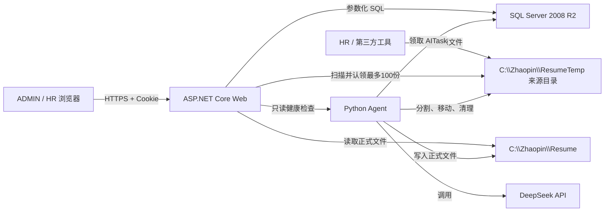
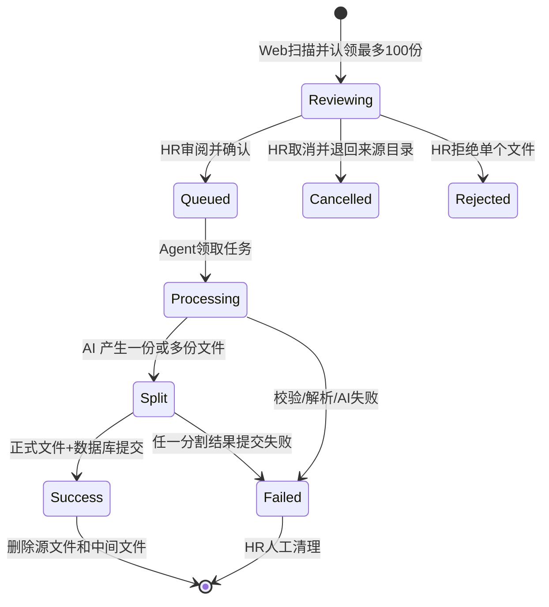

# AI 智能招聘筛选系统 V1——Web 开发部分详细设计

> **V1.1 JSON-only变更（2026-08-12，优先级最高）**：简历只允许通过51JOB客户端上传JSON。Web页面不提供文件上传或“扫描临时目录”按钮；服务端不扫描`HRUpload`，不接收、不校验、不分割、不优化Word/PDF。客户端每批上传后调用内部JSON自动扫描接口，生成HR审阅批次。正式存储只有数据库记录和`C:\Zhaopin\Resume\JSON\yyyy\MM\*.json`。`ResumeTemp`运行时入口仅为`ThirdPartyImport`，`Processing`和`Failed`在审阅或异常期间按需创建。本文后续凡与本段冲突的旧描述均已废止。

版本：V1.0（代码生成前审查稿）  
日期：2026-08-08  
目标框架：ASP.NET Core 8 / `net8.0`  
数据库：SQL Server 2008 R2，兼容级别 100  
部署：Windows Server 2016 + IIS，文件夹发布  
文档状态：待审查；第 18 节 P0 决策确认后方可生成完整业务代码

## 1. 文档目的

本文是 Web 端的代码级规格，约束下一步交付的目录、类、接口、页面、事务、文件操作、权限、错误码和测试。代码实现不得自行改变本文中标记为“已确定”的规则；“待审查”事项必须按第 18 节处理。

Web 端负责：

- 登录、用户与角色权限；
- 岗位与评分配置；
- 第三方JSON自动扫描、待审阅批次及HR确认导入入口；
- 导入批次、AI 任务及处理进度展示；
- 候选人、简历、AI 档案与岗位匹配结果查询；
- HR 人工复核；
- 知识文本维护；
- 文件下载、软删除、清理申请与审计查询；
- 数据库、文件目录和 Agent 健康检查。

Web端不负责：DeepSeek调用、Embedding、任务租约执行和正式物理清理。这些由Python Agent执行；Web只创建任务、查询状态并展示结果。系统不再处理PDF/DOCX。

## 2. 已确定的技术约束

| 项目 | 固定方案 |
|---|---|
| .NET | `.NET 8 / net8.0`，由 `global.json` 固定 SDK 8.0.423 |
| Web | ASP.NET Core MVC + Web API，同一进程、同一站点 |
| 前端 | Razor View + 本地 Bootstrap 5 + 原生 JavaScript；不引入 Node/Vue/React 构建链 |
| 认证 | 同站点 Cookie Authentication；密码使用 `PasswordHasher<TUser>`，不保存明文 |
| 数据访问 | `Microsoft.Data.SqlClient 7.0.2`，参数化 SQL；不引入 EF Core/Dapper |
| 数据库兼容 | 禁止 `OFFSET/FETCH`、`ISJSON()`、Temporal Table 等 SQL Server 2012+ 功能 |
| 分页 | `ROW_NUMBER()`；页码从 1 开始 |
| JSON | `System.Text.Json` 在应用层校验，数据库以 `NVARCHAR(MAX)` 保存 |
| 时间 | 数据库存 UTC，使用 `SYSUTCDATETIME()`；页面按本地时区显示 |
| 文件正式目录 | `C:\Zhaopin\Resume\JSON` |
| 文件临时目录 | `C:\Zhaopin\ResumeTemp` 下的来源、处理、分割和失败子目录 |
| API 风格 | `/api/...` JSON API；错误使用 `application/problem+json` |
| 页面路由 | `/login`、`/admin/...`、`/jobs/...`、`/imports/...`、`/candidates/...` |
| 发布 | `dotnet publish -c Release -r win-x64 --self-contained false` |

说明：第18节决策已全部批准，代码生成必须按本表执行。

## 3. 系统边界与调用关系



浏览器不直接访问物理文件目录，不直接访问 Agent，不接触数据库连接串和 DeepSeek Key。

## 4. 建议解决方案结构

```text
src
├── RecruitAI.Web
│   ├── Controllers
│   │   ├── Api
│   │   └── Pages
│   ├── Authorization
│   ├── Contracts
│   │   ├── Requests
│   │   └── Responses
│   ├── Filters
│   ├── Middleware
│   ├── Options
│   ├── Views
│   ├── wwwroot
│   └── Program.cs
├── RecruitAI.Application
│   ├── Abstractions
│   ├── Common
│   ├── Auth
│   ├── Users
│   ├── Jobs
│   ├── Imports
│   ├── Candidates
│   ├── Matching
│   ├── Knowledge
│   └── Tasks
├── RecruitAI.Domain
│   ├── Entities
│   ├── Enums
│   ├── Rules
│   └── Exceptions
└── RecruitAI.Infrastructure
    ├── Database
    │   ├── Repositories
    │   └── Sql
    ├── Files
    ├── Security
    ├── Agent
    └── Time
tests
└── RecruitAI.Tests
    ├── Unit
    ├── Integration
    └── Api
```

依赖方向：`Web -> Application`，`Infrastructure -> Application + Domain`，`Application -> Domain`，`Domain` 不依赖其他项目。`Web` 在组合根注册 `Infrastructure` 实现。

禁止事项：Controller 直接执行 SQL、Repository 返回 HTTP 类型、Domain 读取配置、Application 操作 `HttpContext`、页面拼接服务器文件路径。

## 5. 核心类型与编码约定

### 5.1 标识与并发

- 数据库主键映射为 C# `long`；URL 参数非法或小于 1 返回 400。
- `ROWVERSION` 对外编码为 Base64 字符串 `rowVersion`。
- 修改请求必须携带 `rowVersion`；SQL 使用 `WHERE Id=@Id AND RowVersion=@RowVersion`。
- 受影响行数为 0 时返回 409，错误码 `CONCURRENCY_CONFLICT`。

### 5.2 枚举

业务状态在 Domain 中使用枚举，Repository 显式转换为数据库大写字符串。未知数据库状态必须抛出数据一致性异常，不得静默映射。

必须定义：

- `UserStatus`: `Active`, `Disabled`, `Locked`；
- `JobStatus`: `Draft`, `Open`, `Closed`, `Archived`；
- `CandidateStatus`: `New`, `Analyzing`, `Screened`, `Interview`, `Rejected`, `Archived`；
- `ResumeParseStatus`: `Waiting`, `Parsing`, `Success`, `Failed`；
- `CandidateJobStatus`: `Pending`, `Recommended`, `Hold`, `Interview`, `Rejected`；
- `AiTaskStatus`: `Waiting`, `Running`, `Success`, `Failed`, `Cancelled`；
- `ImportSourceType`: `HrUpload`, `ThirdPartyImport`；
- `ImportStatus`: `Reviewing`, `Queued`, `Processing`, `Success`, `PartialSuccess`, `Failed`, `Cancelled`；
- `ImportFileStatus`: `Claimed`, `ReviewReady`, `Queued`, `Processing`, `Split`, `Success`, `Failed`, `Rejected`, `Cancelled`。

### 5.3 通用结果

查询列表统一返回：

```json
{
  "items": [],
  "page": 1,
  "pageSize": 20,
  "totalCount": 0,
  "totalPages": 0
}
```

命令成功：创建返回 201 和资源 DTO；更新返回 200；无响应内容的动作返回 204。不得把业务失败包装为 HTTP 200。

### 5.4 ProblemDetails

所有异常由 `ExceptionHandlingMiddleware` 转换：

```json
{
  "type": "https://recruitai.local/problems/validation",
  "title": "请求参数不正确",
  "status": 400,
  "detail": "一个或多个字段校验失败。",
  "instance": "/api/jobs/12",
  "code": "VALIDATION_FAILED",
  "traceId": "...",
  "errors": { "name": ["岗位名称不能为空"] }
}
```

| HTTP | 使用场景 |
|---:|---|
| 400 | 参数、状态流转、文件格式不合法 |
| 401 | 未登录或登录失效 |
| 403 | 已登录但无权限 |
| 404 | 资源不存在或已软删除 |
| 409 | 重复数据、状态冲突、RowVersion 冲突 |
| 413 | 单文件、批次或请求体超限 |
| 415 | 不支持的文件类型 |
| 422 | 文件结构可读取但业务内容无法处理 |
| 500 | 未处理异常；响应不得泄露 SQL、路径、堆栈和密钥 |
| 503 | 数据库、文件系统或 Agent 不可用 |

## 6. 认证、会话与授权

### 6.1 登录实现

使用自定义 `AppUser` 表配合 Cookie Authentication，不使用完整 ASP.NET Core Identity 表组。

核心接口：

```csharp
public interface IAuthenticationService
{
    Task<LoginResult> LoginAsync(LoginCommand command, CancellationToken ct);
    Task<AppUserSession?> GetSessionAsync(long userId, CancellationToken ct);
}

public interface IUserPasswordService
{
    string Hash(AppUser user, string password);
    bool Verify(AppUser user, string password, string passwordHash);
}
```

Cookie Claims 只保存：`NameIdentifier`、`Name`、`DisplayName`、`Role`。数据库状态必须在登录时校验；高风险管理员操作可再次查询用户状态。

Cookie 配置默认值：

- 名称：`RecruitAI.Auth`；
- 登录路径：`/login`；
- 访问拒绝：`/forbidden`；
- `HttpOnly=true`、`SameSite=Lax`；
- 生产 `SecurePolicy=Always`，开发 `SameAsRequest`；
- 空闲超时 8 小时，滑动续期；
- 不实现“永久记住我”，除非审查明确要求。

### 6.2 密码和登录失败规则

- 普通新建/重置密码为 8～64 字符，至少包含字母和数字；初始化 ADMIN 的 `123456` 是部署种子例外。
- `PasswordHasher<AppUser>` 默认兼容哈希；禁止自定义 MD5/SHA 明文摘要。
- 登录失败响应统一为“用户名或密码错误”，不得暴露账号存在性。
- 首次登录不强制修改密码，登录失败不锁定账号，也不累计数据库失败次数。
- 为避免无限暴力请求，登录接口按“IP + 规范化用户名”限速：默认每分钟 10 次；触发限速返回 429，但不改变 AppUser.Status。
- ADMIN 初始账号为 `admin`，初始密码为 `123456`；只在不存在任何 ADMIN 用户时初始化，使用 PasswordHasher 写入哈希，不在日志打印明文。

### 6.3 策略

```text
AdminOnly       Role = ADMIN
Recruitment     Role = ADMIN 或 HR
Authenticated   任意有效登录用户
```

所有 `/api` 默认要求认证，例外只有 `/api/auth/login`、`/api/health/live`。管理用户、审计日志、系统健康详情仅 ADMIN；岗位、导入、候选人、评分和知识内容为 Recruitment。

### 6.4 CSRF

Cookie 认证下所有 POST/PUT/PATCH/DELETE 必须校验 Antiforgery。Razor 页面输出 token；JavaScript 通过 `X-CSRF-TOKEN` 请求头提交。登录接口也校验 token。纯 GET 不得改变状态。

## 7. 数据访问详细设计

### 7.1 基础设施接口

```csharp
public interface ISqlConnectionFactory
{
    Task<SqlConnection> OpenAsync(CancellationToken ct);
}

public interface ITransactionScope : IAsyncDisposable
{
    SqlConnection Connection { get; }
    SqlTransaction Transaction { get; }
    Task CommitAsync(CancellationToken ct);
    Task RollbackAsync(CancellationToken ct);
}
```

Repository 方法必须接收 `CancellationToken`。事务由 Application 用例开启并传递，不使用分布式事务。

### 7.2 SQL 规则

- 只用参数，禁止字符串拼接值；动态排序只能从白名单映射到固定列名。
- 字符串参数显式设置 `SqlDbType.NVarChar` 和长度，避免隐式转换。
- 时间参数使用 `DateTimeOffset.UtcNow.UtcDateTime` 或 `IClock.UtcNow`。
- 列表查询不得选择 `RawText`、`AIReport`、`StructuredJson` 等大字段。
- 使用 `CommandTimeout`：普通查询 30 秒，管理报表最多 60 秒；超时必须日志记录 `traceId`，不记录参数中的隐私正文。
- SQL Server 2008 R2 分页模板：内层 `ROW_NUMBER() OVER (...)`，外层 `WHERE RowNum BETWEEN @Start AND @End`。
- 模糊搜索转义 `%`、`_`、`[`，使用 `LIKE @Keyword ESCAPE '\'`。
- 创建主键可使用 `OUTPUT inserted.Id`；禁止 `SELECT MAX(Id)`。

### 7.3 事务边界

以下操作必须单事务：

- 创建/更新岗位及评分配置版本；
- HR 人工复核并写复核人、时间；
- 创建导入批次、文件记录和幂等任务；
- Agent 完成导入时创建/匹配 Candidate、创建 Resume、替换当前版本、创建/更新 AITask、写 CleanupLog；
- 软删除和清理任务创建。

文件系统与 SQL 无法形成原子事务，必须使用第 10 节的状态机和补偿策略。

## 8. Web API 总表

### 8.1 认证与用户

| 方法 | 路径 | 权限 | 说明 |
|---|---|---|---|
| POST | `/api/auth/login` | 匿名 | 登录并写 Cookie |
| POST | `/api/auth/logout` | 已登录 | 注销 Cookie |
| GET | `/api/auth/me` | 已登录 | 当前用户 |
| POST | `/api/auth/change-password` | 已登录 | 用户主动修改本人密码；成功后注销现有会话 |
| GET | `/api/admin/users` | ADMIN | 用户分页查询 |
| POST | `/api/admin/users` | ADMIN | 创建用户 |
| GET | `/api/admin/users/{id}` | ADMIN | 用户详情 |
| PUT | `/api/admin/users/{id}` | ADMIN | 修改显示名、邮箱、角色，需 rowVersion |
| POST | `/api/admin/users/{id}/disable` | ADMIN | 禁用 |
| POST | `/api/admin/users/{id}/enable` | ADMIN | 启用 |
| POST | `/api/admin/users/{id}/reset-password` | ADMIN | 重置密码 |

`POST /api/auth/login`：

```json
{ "userName": "hr01", "password": "********" }
```

成功返回 `{ "id": 2, "userName": "hr01", "displayName": "张HR", "role": "HR" }`。不能把 `PasswordHash` 放入任何 DTO。

### 8.2 岗位与评分配置

| 方法 | 路径 | 说明 |
|---|---|---|
| GET | `/api/jobs?page=1&pageSize=20&status=OPEN&keyword=` | 分页查询 |
| POST | `/api/jobs` | 创建草稿岗位 |
| GET | `/api/jobs/{id}` | 详情及当前评分配置 |
| PUT | `/api/jobs/{id}` | 修改草稿/开放岗位，需 rowVersion |
| POST | `/api/jobs/{id}/open` | 发布岗位 |
| POST | `/api/jobs/{id}/close` | 关闭岗位 |
| DELETE | `/api/jobs/{id}` | 软删除；仅 DRAFT/CLOSED |
| PUT | `/api/jobs/{id}/score-config` | 新建下一配置版本 |

创建/修改请求字段：`name(1..200)`、`description(<=10000)`、`requirement(1..20000)`、`skillRequirement(<=10000)`、`minExperienceMonths(0..720)`、`educationRequirement(<=100)`、`rowVersion`（更新时）。

评分配置：四项 `decimal` 权重范围 0～100，精确到两位，总和必须严格为 `100.00`；`ruleJson` 最大 20000 字符且应用层必须是 JSON object。默认 40/30/20/10。

岗位状态流转：

```text
DRAFT -> OPEN -> CLOSED -> OPEN
DRAFT/CLOSED -> ARCHIVED
ARCHIVED 不可恢复（V1）
```

### 8.3 导入批次

“上传简历”不是浏览器文件上传。HR 或第三方工具预先把 PDF/DOCX/JSON 放入 `ResumeTemp\HRUpload` 或 `ResumeTemp\ThirdPartyImport`；HR 在 Web 点击“上传简历”后，Web 同时扫描两个来源目录并认领最多 100 个可用源文件，形成一个待审阅批次。JSON必须含 `talent_id`、`source_route`、`candidate_name` 和 `visible_text`；联系方式允许缺失。

51JOB客户端在生成JSON和上传服务器前均清洗 `visible_text`：删除页面导航、操作按钮、人才ID页头、通知数字、页尾声明/操作动态及连续重复企业水印，保留候选人基本信息和简历业务章节。Python Agent执行同规则的幂等兜底清洗，原始JSON备份仅用于故障恢复，不进入AI提示。

| 方法 | 路径 | 说明 |
|---|---|---|
| POST | `/api/resume-imports/scan` | 扫描两个来源目录，认领最多 100 个文件 |
| GET | `/api/resume-imports` | 批次分页列表 |
| GET | `/api/resume-imports/{batchId}` | 批次、文件、错误和任务进度 |
| POST | `/api/resume-imports/{batchId}/files/{fileId}/reject` | HR 标记本文件不导入，移入 Failed |
| POST | `/api/resume-imports/{batchId}/confirm` | HR 确认审阅结果并创建导入任务 |
| POST | `/api/resume-imports/{batchId}/cancel-review` | 取消审阅，将未拒绝文件退回原来源目录 |
| GET | `/api/resume-imports/failed-files` | HR查看待人工处理的异常文件 |
| POST | `/api/resume-imports/failed-files/{fileId}/purge` | HR填写原因后人工物理清理异常文件 |

扫描请求不接收服务器路径，也不接收文件流：

```json
{}
```

发现文件时返回 201：

```json
{
  "result": "BATCH_CREATED",
  "batchId": 25,
  "selectedCount": 100,
  "reviewReadyCount": 97,
  "failedValidationCount": 3,
  "hrUploadCount": 40,
  "thirdPartyCount": 60,
  "hasMore": true,
  "message": "已读取100份简历，请审阅后确认导入。"
}
```

没有可认领文件时不创建空批次，返回 200：

```json
{
  "result": "EMPTY",
  "selectedCount": 0,
  "hasMore": false,
  "message": "无可用简历。"
}
```

`hasMore` 是扫描完成时的提示值；外部工具可能随后继续放入文件，因此最终结束标准仍是 HR 再次点击“上传简历”并收到 `EMPTY`。

确认请求在审阅完成后提交岗位和备注：

```json
{
  "jobIds": [10, 11],
  "remark": "2026年8月招聘",
  "rowVersion": "AAAAAAAAB9E="
}
```

确认规则：批次必须为 `REVIEWING`；至少有一个 `REVIEW_READY` 文件；岗位必须存在、未删除且为 OPEN。确认事务写入岗位映射，将可导入文件转为 QUEUED，并为每个文件创建幂等 `RESUME_IMPORT` 任务。API 返回 202 和任务数量，不等待 AI 处理。生产 Agent 默认并发为 10，通过 `WORKER_CONCURRENCY` 配置；每个任务仍独立认领、独立事务写入。

同一 HR 同时只允许一个 `REVIEWING` 批次；再次点击扫描时返回 409 `IMPORT_REVIEW_PENDING` 并跳转已有批次，防止一个人遗留多个未确认批次。其他 HR 可查看该批次，但只有创建人或 ADMIN 可以确认、拒绝或取消。

### 8.4 候选人和简历

| 方法 | 路径 | 说明 |
|---|---|---|
| GET | `/api/candidates` | 姓名、状态、技能、来源、分页筛选 |
| GET | `/api/candidates/{id}` | 候选人聚合详情 |
| PUT | `/api/candidates/{id}` | 修改基础联系方式，需 rowVersion |
| GET | `/api/candidates/{id}/resumes` | 简历版本列表 |
| GET | `/api/resumes/{id}/download` | 鉴权下载，不暴露物理路径 |
| POST | `/api/resumes/{id}/reparse` | 创建幂等解析任务 |
| DELETE | `/api/resumes/{id}` | 软删除并创建清理任务 |
| DELETE | `/api/candidates/{id}` | 软删除候选人及创建清理任务 |

列表筛选：`keyword`、`status`、`skill`、`source`、`createdFrom`、`createdTo`、`page`、`pageSize`。`pageSize` 允许 10/20/50/100，默认 20。

候选人详情 DTO 包含：基础信息、当前简历元数据、CandidateProfile、skills、educations、workExperiences、projects、匹配摘要。大字段 `RawText` 默认不返回；需要时由独立接口按权限加载。

下载规则：从数据库取得相对路径，组合正式根目录后执行 `Path.GetFullPath`，结果必须位于 `ResumeRoot`；使用内部路径打开流，响应下载名为清理后的原始文件名，设置 `Content-Disposition: attachment`、`X-Content-Type-Options: nosniff`、`Cache-Control: private, no-store`。

### 8.5 岗位匹配与复核

| 方法 | 路径 | 说明 |
|---|---|---|
| POST | `/api/jobs/{jobId}/analysis` | 为候选人创建匹配/评分任务 |
| GET | `/api/jobs/{jobId}/candidates` | 分数排序和筛选 |
| GET | `/api/candidate-jobs/{id}` | 完整评分报告 |
| PATCH | `/api/candidate-jobs/{id}/review` | 人工评分和状态复核 |
| POST | `/api/candidate-jobs/{id}/reanalyze` | 重新评分 |

分析请求：

```json
{ "candidateIds": [1, 2, 3], "force": false }
```

最多 100 个不重复正整数 ID；岗位必须 OPEN；候选人必须有解析成功的当前简历。用 `BusinessKey=match-score:{candidateJobId}:{resumeId}:{scoreConfigVersion}` 幂等。

复核请求：

```json
{
  "manualScore": 88.50,
  "status": "INTERVIEW",
  "reason": "项目经验与岗位高度匹配",
  "rowVersion": "AAAAAAAAB9E="
}
```

`manualScore` 可为空（恢复使用 AI 分），否则 0～100；状态仅允许 `RECOMMENDED/HOLD/INTERVIEW/REJECTED`。保存 `ReviewedBy/ReviewedTime`，不得覆盖 AIScore。每次变更按第 11.7 节追加复核历史，禁止只保留最后结果。

岗位候选人默认排序：`COALESCE(ManualScore,AIScore) DESC, CandidateJob.UpdateTime DESC`。筛选包括状态、最终分区间、候选人姓名和技能。

### 8.6 知识库、任务和审计

| 方法 | 路径 | 权限 | 说明 |
|---|---|---|---|
| GET/POST | `/api/knowledge-documents` | Recruitment | 文本知识列表/创建 |
| GET/PUT/DELETE | `/api/knowledge-documents/{id}` | Recruitment | 详情/版本更新/软删除 |
| POST | `/api/knowledge-documents/{id}/reindex` | Recruitment | 创建向量任务 |
| POST | `/api/knowledge-imports/excel` | Recruitment | 上传并解析 `.xlsx`，不调用AI |
| GET | `/api/knowledge-imports/{batchId}` | Recruitment | 行级校验、重复和冲突结果 |
| PATCH | `/api/knowledge-imports/{batchId}/rows/{rowId}` | Recruitment | 在管理页修正冲突行 |
| POST | `/api/knowledge-imports/{batchId}/confirm` | Recruitment | 无冲突后合并知识库并创建Embedding任务 |
| GET | `/api/ai-tasks` | Recruitment | 状态、类型、日期筛选 |
| GET | `/api/ai-tasks/{id}` | Recruitment | 任务详情，错误脱敏 |
| POST | `/api/ai-tasks/{id}/retry` | Recruitment | 非RESUME_IMPORT的FAILED任务可重试；失败简历不重试 |
| POST | `/api/ai-tasks/{id}/cancel` | Recruitment | WAITING 才允许取消 |
| GET | `/api/admin/cleanup-logs` | ADMIN | 只读审计查询 |

知识库支持页面文本维护和Excel导入，不支持知识PDF/DOCX。Excel只允许Open XML `.xlsx`，禁止 `.xls/.xlsm`。上传使用 `multipart/form-data` 字段 `file`，最大10MB、最多5000条数据行；解析过程不调用DeepSeek。

固定工作表名为 `Knowledge`，第一行为表头：

| 列 | 必填 | 规则 |
|---|---:|---|
| 知识编码 | 是 | 1～100字符，字母、数字、`-`、`_`，全局唯一 |
| 标题 | 是 | 1～300字符 |
| 文档类型 | 是 | `JOB_REQUIREMENT/TECH_STANDARD/TALENT_STANDARD/SCORE_RULE/OTHER` |
| 内容 | 是 | 去首尾空白后1～50000字符 |

安全解析规则：只读取单元格文本；不计算公式，发现公式、宏、外部链接、嵌入对象或非指定工作表时将对应批次/行标为INVALID；不启动Excel进程。

冲突以知识编码为主键：不存在为READY；编码存在且ContentHash相同为DUPLICATE并跳过；编码存在但标题、类型或内容不同为CONFLICT。管理页面逐行显示现有值和Excel值，HR可修改暂存行；仍有CONFLICT/INVALID时禁止确认。确认事务新增KnowledgeDocument或将已有文档Version+1并写入新内容，随后创建 `KNOWLEDGE_EMBED`，状态转INDEXING；Embedding成功后转ACTIVE。

### 8.7 健康检查

| 路径 | 匿名 | 返回 |
|---|---:|---|
| `/api/health/live` | 是 | 进程存活，不访问依赖 |
| `/api/health/ready` | 否 | 数据库、正式目录、临时目录 |
| `/api/health/database` | 否 | `SELECT 1` 与版本摘要 |
| `/api/health/agent` | 否 | Agent `/health`，2 秒超时 |

非 ADMIN 的 ready 响应只返回 Healthy/Degraded/Unhealthy，不返回服务器名、SQL 版本和物理路径。

## 9. 页面详细设计

页面使用统一 `_Layout.cshtml`：顶部显示当前用户和退出，左侧导航按角色渲染；所有按钮还必须由 API 权限二次校验，隐藏按钮不能代替授权。

| 页面 | 路由 | 主要内容 |
|---|---|---|
| 登录 | `/login` | 用户名、密码、错误提示 |
| 修改密码 | `/change-password` | 本人主动修改密码 |
| 首页 | `/` | 开放岗位、等待/失败任务、最近导入、候选人数量 |
| 用户管理 | `/admin/users` | ADMIN 用户列表、创建、禁用、重置密码 |
| 岗位列表 | `/jobs` | 搜索、状态筛选、新建、开放/关闭 |
| 岗位编辑 | `/jobs/create`、`/jobs/{id}/edit` | 岗位字段、RowVersion |
| 岗位详情 | `/jobs/{id}` | 要求、评分权重、分析入口、候选人排名 |
| 简历导入 | `/imports` | “上传简历”扫描按钮、来源计数、无可用简历提示及历史批次 |
| 导入记录 | `/imports` | 状态、来源、成功/失败计数、创建人和时间 |
| 导入详情 | `/imports/{id}` | 文件级进度、错误、审阅拒绝、批次取消；失败简历不提供重试 |
| 候选人列表 | `/candidates` | 搜索、状态、技能、来源、分页 |
| 候选人详情 | `/candidates/{id}` | 档案、经历、简历、匹配、AI 版本信息 |
| 岗位候选人 | `/jobs/{id}/candidates` | 最终分排序、筛选、批量分析 |
| 匹配详情 | `/candidate-jobs/{id}` | 四项分、证据、优缺点、复核表单 |
| 知识库 | `/knowledge` | 文本知识CRUD、Excel上传、索引状态 |
| 知识导入冲突 | `/knowledge/imports/{id}` | Excel行校验、现有/导入值对比、页面修正和确认合并 |
| AI 任务 | `/tasks` | 类型、状态、进度、失败重试 |
| 清理日志 | `/admin/cleanup-logs` | ADMIN 只读查询 |

页面规则：

- 首次加载由 MVC 返回页面骨架，数据通过同源 API 获取。
- 列表筛选写入 URL query，刷新后保持；翻页保留筛选条件。
- 所有提交按钮点击后立即禁用，响应结束恢复，避免重复提交。
- “上传简历”按钮调用目录扫描 API，不显示浏览器文件选择框；扫描成功后直接进入待审阅批次详情。
- 待审阅页逐项显示来源、原文件名、大小、格式校验和重复提示；确认前不解析正文、不提供可执行文档预览；HR可拒绝单项，确认时只导入 `REVIEW_READY` 文件。
- 批次成功/部分成功后，如 `hasMore=true`，页面提示“临时目录仍有简历，请继续点击上传简历”；HR重复执行直至扫描接口提示“无可用简历”。
- 导入进度页面在批次未结束时每 5 秒轮询，页面隐藏时停止；结束后停止轮询。
- 日期显示 `yyyy-MM-dd HH:mm:ss`，空值显示 `—`；分数两位小数。
- AI 内容必须以文本方式插入 DOM，禁止未经净化使用 `innerHTML`。
- 每个 AI 评分页面固定展示：“AI 分析仅供辅助，最终决定由 HR 作出”。

## 10. 临时目录扫描、审阅、物理分割与清理

### 10.1 目录

```text
C:\Zhaopin\ResumeTemp
├── HRUpload
├── ThirdPartyImport
├── Processing
│   └── {batchGuid}
│       ├── HRUpload
│       └── ThirdPartyImport
├── SplitOutput
└── Failed
```

`HRUpload` 由 HR 或受控人工流程放入简历；`ThirdPartyImport` 由第三方工具放入简历。Web 只扫描这两个固定来源，不递归扫描其他目录，不接受用户提交目录路径。

认领相对路径：`Processing/{batchGuid:N}/{source}/{fileGuid:N}.{ext}`。  
正式相对路径：`{PDF|DOCX|JSON}/{yyyy}/{MM}/{fileGuid:N}.{ext}`。

数据库只保存相对于对应根目录的路径，同时保存原始文件名和原来源类型，禁止保存客户端或第三方工具提供的绝对路径。

### 10.2 配置默认值

```json
{
  "FileStorage": {
    "ResumeRoot": "C:\\Zhaopin\\Resume",
    "ResumeTempRoot": "C:\\Zhaopin\\ResumeTemp"
  },
  "ResumeImport": {
    "AllowedExtensions": [".pdf", ".docx"],
    "TargetFileBytes": 20971520,
    "HardMaxSourceFileBytes": 524288000,
    "MaxFilesPerScan": 100,
    "MinimumStableSeconds": 30,
    "AutoDeleteFailedFiles": false,
    "ReviewRetentionHours": 24
  }
}
```

`MaxFilesPerScan` 可配置为 1～100，生产固定 100，禁止配置超过 100。启动时使用 `IValidateOptions<T>` 校验：两个根目录必须为绝对路径且互不包含；临时子目录必须位于临时根下；生产目录不存在或不可读写时 readiness 为 Unhealthy，应用不自行放宽 ACL。

### 10.3 扫描与认领算法

1. 检查当前用户没有未完成的 `REVIEWING` 批次；
2. 通过 SQL Server `sp_getapplock` 获取资源名 `RecruitAI:ResumeTempScan` 的 Session 级 Exclusive 锁，超时设为 0；未取得锁返回 409 `IMPORT_SCAN_BUSY`，确保全站同一时刻只有一个扫描过程；
3. 只枚举 `HRUpload`、`ThirdPartyImport` 顶层的普通文件，不跟随符号链接或重解析点；
4. 过滤扩展名 `.pdf/.docx`；其他文件不计为“可用简历”，在响应中返回 `ignoredCount`，但不擅自删除；
5. 文件最后写入时间距当前至少 30 秒，并能以独占读方式打开，才视为复制完成；正在写入或被占用的文件本轮跳过；
6. 两个来源文件合并排序：`LastWriteTimeUtc ASC`，相同按来源和完整文件名的 OrdinalIgnoreCase 顺序；
7. 从排序结果逐个尝试原子移动到 `Processing/{batchGuid}/{source}`，成功移动即完成认领；被其他进程先移动的文件跳过；
8. 认领满 100 个立即停止；100按临时目录源文件计数，不按AI分割后的简历数计数；合并文件分割结果即使使本批正式简历数量超过100，也必须继续完成本批，不拆分为续批；
9. 对认领文件流式计算大小和 SHA-256；原始文件名只用于展示，内部文件名使用 GUID；
10. PDF 文件头必须以 `%PDF-` 开始；DOCX 必须为 ZIP 且包含 `[Content_Types].xml` 和 `word/document.xml`；
11. 合法文件写为 `REVIEW_READY`；空文件、超过500MB硬安全上限、结构错误或同批Hash重复写为 `FAILED` 并移动到 `Failed/{batchGuid}`；超过20MB但未超过硬上限的源文件仍允许审阅和确认，待Agent分割后执行第10.6节优化；
12. 在一个数据库事务中写 ResumeImportBatch 和 ResumeImportFile；数据库失败时将已认领的合法文件原子退回原来源目录；发生同名冲突时追加安全后缀，禁止覆盖新文件；
13. 事务提交后返回批次、来源计数、校验计数和 `hasMore`。没有认领到任何稳定且扩展名受支持的文件时不创建批次并返回 `EMPTY`；认领到了文件但全部校验失败时仍创建 FAILED 批次供 HR 查看原因，不允许确认导入。

不得将整个文件加载到内存。扫描日志只记录批次 ID、服务端文件 ID、来源、大小、Hash 前 12 位和状态，不记录简历正文或完整物理路径。

扫描只由用户点击触发，不设置后台自动扫描和目录监听，确保每批由 HR 明确发起和审阅。

### 10.4 审阅规则

- 扫描成功后批次状态为 `REVIEWING`，不会创建 AI 任务，也不会写入正式简历库和 Candidate/Resume 表。
- 审阅页不打开原始PDF/DOCX，不渲染超链接；只显示文件元数据、格式校验和重复提示。
- HR 拒绝的文件移动到 `Failed/{batchGuid}/Rejected`，状态为 `REJECTED`，记录操作人、时间和原因。
- Failed/Rejected文件不自动重试、不自动删除、不按天数过期；异常管理页面由HR人工判断。人工清理必须填写1～500字原因，只允许清理Failed根目录内且数据库状态为FAILED/REJECTED的文件，并写CleanupLog `PURGE_FAILED_IMPORT`。
- HR 取消整个审阅时，将尚未拒绝的文件退回各自原来源目录，批次改为 `CANCELLED`；下次点击可再次扫描。
- 审阅超过 24 小时未确认时不自动导入。系统提示创建人处理；是否自动取消由清理任务按配置执行。
- HR 确认后批次和文件转为 `QUEUED`，之后禁止修改选择；Web 只创建任务并立即返回。
- HR确认前不调用DeepSeek，不生成候选人预解析结果；审阅内容仅包括来源、原文件名、大小、格式/Hash校验和重复提示，避免无效Token消耗。

### 10.5 状态与责任



成功判定顺序：

1. HR 已确认批次，Agent 才能领取文件；
2. Agent 在 `SplitOutput` 完成分割并关闭所有文件句柄；
3. 对每份简历计算 Hash、校验格式并生成正式目标名；
4. 移动到 `Resume`；
5. 在数据库事务中完成候选人去重、Resume、Profile/任务/日志写入；
6. 提交事务并将导入文件标记 SUCCESS；
7. 只删除本导入文件对应的 `Processing` 源文件和 `SplitOutput` 中间文件。

对于一份源文件分割出多份简历的情况，只有该源文件的所有待导入分割结果均完成数据库处理后才删除源文件。部分成功时源文件移动到 Failed 并保留结果映射，不自动重试或自动删除，由 HR 人工处理。

正式文件移动成功但数据库失败时，Agent 将正式文件移回失败隔离区或记录为孤儿文件等待补偿，禁止无记录留在正式目录。数据库成功但临时删除失败不回滚业务成功，记录 `TEMP_DELETE_FAILED` 并由清理任务重试。

所有删除必须调用统一 `ITempFileStore.DeleteAsync(relativePath)`；实现先 `GetFullPath`，确认结果严格位于 `ResumeTempRoot + DirectorySeparatorChar` 下，拒绝符号链接/重解析点和根目录本身。业务代码不得直接调用 `File.Delete`。

### 10.6 超过20MB的去图优化

20MB是每份分割后正式简历的目标上限，不是临时合并源文件的直接拒绝上限。优化只在HR确认后由Agent执行，不消耗DeepSeek Token。

1. Agent先物理分割，再逐份检查结果大小；小于等于20MB直接进入文本提取；
2. 大于20MB时先提取纯文本并保存文本Hash，扫描PDF无文本或DOCX无有效正文直接标记 `NO_TEXT_CONTENT`，移动到Failed；
3. 在 `SplitOutput` 创建副本，禁止原地修改Processing源文件；
4. PDF按嵌入图片占用从大到小移除，DOCX按媒体文件占用从大到小移除，只移除图片，不删除段落、表格和可见文字；
5. 每轮移除后重新保存并检查大小，达到20MB以内立即停止；
6. 重新提取优化后文本，规范化文本必须与优化前一致；不一致、文件打不开或仍超过20MB时标记 `FILE_OPTIMIZE_FAILED` 并移动到Failed；
7. 只有校验通过的优化副本可进入正式Resume目录；Resume记录保存原始大小、正式大小和是否优化；
8. 原临时源文件只在该源文件全部分割结果成功后删除。

不调用Microsoft Office、不执行PDF JavaScript、附件、Launch Action、宏、OLE对象或超链接。解析器只读取文档文字和结构；超链接只保留显示文字，URI不进入AI Prompt，也不生成可点击HTML。

## 11. 已批准的数据模型扩展

现有表无法保存“已从临时目录认领、正在等待 HR 审阅，但还没有 Candidate/Resume 的文件”。已批准新增以下表，不创建占位候选人。

V003同时扩展现有 `dbo.Resume`：新增可空 `TalentId NVARCHAR(100)` 和 `ResumeSource NVARCHAR(100)`，并建立 `(ResumeSource,TalentId)` 非唯一过滤索引。JSON文件名必须为 `{来源}_{人才ID}.json`，`ResumeSource` 取首个下划线前缀，文件名人才ID必须与内容 `talent_id` 一致；PDF/DOCX的 `TalentId` 为空，`ResumeSource` 取 `HR_UPLOAD` 或 `THIRD_PARTY_IMPORT`。JSON联系方式固定为空，仅以“来源 + 人才ID”关联；PDF/DOCX仍按手机号、邮箱匹配。任何身份冲突均标记异常，不按姓名自动合并。

### 11.1 ResumeImportBatch

| 字段 | 类型 | 说明 |
|---|---|---|
| Id | BIGINT IDENTITY | 主键 |
| BatchKey | UNIQUEIDENTIFIER | 对外不可预测标识，唯一 |
| Remark | NVARCHAR(500) NULL | 备注 |
| Status | VARCHAR(20) | 批次状态 |
| SourceFileCount | INT | 源文件数 |
| HrUploadCount | INT | HR 来源源文件数 |
| ThirdPartyCount | INT | 第三方来源源文件数 |
| ResumeFileCount | INT | 分割后简历数 |
| SuccessCount | INT | 成功数 |
| FailedCount | INT | 失败数 |
| CreatedBy | BIGINT | AppUser |
| ConfirmedBy | BIGINT NULL | 确认导入用户 |
| ConfirmTime/FinishTime | DATETIME2(3) NULL | 时间 |
| CreateTime/UpdateTime | DATETIME2(3) | UTC |
| RowVersion | ROWVERSION | 并发 |

### 11.2 ResumeImportFile

| 字段 | 类型 | 说明 |
|---|---|---|
| Id | BIGINT IDENTITY | 主键 |
| BatchId | BIGINT | 批次 FK |
| SourceType | VARCHAR(30) | HR_UPLOAD / THIRD_PARTY_IMPORT，由来源目录确定 |
| OriginalFileName | NVARCHAR(260) | 原文件名 |
| FileExtension | VARCHAR(10) | PDF/DOCX/JSON |
| OriginalSourcePath | NVARCHAR(1000) | 原来源相对路径，用于取消审阅时退回 |
| TempFilePath | NVARCHAR(1000) | Processing 下认领后的相对路径 |
| FileSize | BIGINT | 字节数 |
| FileHash | CHAR(64) | SHA-256 |
| Status | VARCHAR(20) | 文件状态 |
| DetectedResumeCount | INT NULL | 物理分割数量 |
| ErrorCode | VARCHAR(100) NULL | 稳定错误码 |
| ErrorMessage | NVARCHAR(2000) NULL | 脱敏错误 |
| RetryCount | INT | 重试次数 |
| ReviewedBy | BIGINT NULL | 拒绝或确认审阅用户 |
| ReviewTime | DATETIME2(3) NULL | 审阅时间 |
| CreateTime/UpdateTime | DATETIME2(3) | UTC |
| RowVersion | ROWVERSION | 并发 |

索引：`(BatchId, FileHash)`、`(BatchId, Status, Id)`、`(Status, UpdateTime)`。同批Hash重复的每个物理文件仍需分别登记，其中第一份可进入审阅，后续重复项标记 `FAILED/DUPLICATE_IN_BATCH`，因此 `(BatchId, FileHash)` 不设唯一约束。`OriginalSourcePath` 和 `TempFilePath` 均为相对于 ResumeTempRoot 的受控路径；API 不返回这两个字段。

### 11.3 ResumeImportBatchJob

用于保存导入成功后需要自动匹配的目标岗位，避免在 SQL Server 2008 R2 中依赖 JSON 查询。

| 字段 | 类型 | 说明 |
|---|---|---|
| BatchId | BIGINT | ResumeImportBatch FK |
| JobId | BIGINT | Job FK |
| CreateTime | DATETIME2(3) | UTC |

联合主键：`(BatchId, JobId)`。提交批次时验证岗位存在、未删除且状态为 OPEN。

### 11.4 ResumeImportResult

一份第三方源文件可能物理分割为多份正式简历，本表保存来源到结果的一对多映射。

| 字段 | 类型 | 说明 |
|---|---|---|
| Id | BIGINT IDENTITY | 主键 |
| ImportFileId | BIGINT | ResumeImportFile FK |
| ResumeId | BIGINT | Resume FK |
| SequenceNo | INT | 在源文件中的顺序，从 1 开始 |
| SourcePageStart | INT NULL | PDF 起始页；无法确定时为空 |
| SourcePageEnd | INT NULL | PDF 结束页；无法确定时为空 |
| CreateTime | DATETIME2(3) | UTC |

唯一约束：`(ImportFileId, SequenceNo)`、`ResumeId`。导入详情通过本表跳转到正式简历和候选人。

### 11.5 AITask 扩展

已批准：

- 新增任务类型 `RESUME_IMPORT`；
- `AITask` 新增可空 `ResumeImportFileId`；
- 目标约束扩展为：RESUME_IMPORT 只填写 ResumeImportFileId，RESUME_PARSE 只填写 ResumeId；
- `BusinessKey=resume-import:{importFileId}:{fileHash}`。

上述四张表及 AITask 扩展已经由 `database/V002__web_import_review_knowledge.sql` 交付。导入代码使用这些结构完成扫描认领、审阅确认、目标岗位关联、批次进度、一文件多简历映射和成功后精确清理。

### 11.5.1 Resume 大文件优化字段

为记录超过20MB简历的去图处理，已批准Resume增加：

| 字段 | 类型 | 默认值 | 说明 |
|---|---|---:|---|
| OriginalFileSize | BIGINT NULL | NULL | 分割后、优化前大小；旧数据可空 |
| IsOptimized | BIT NOT NULL | 0 | 是否执行过安全去图优化 |

现有FileSize记录最终正式文件大小，FileHash记录最终正式文件Hash；源文件Hash继续保存在ResumeImportFile。正式新简历必须不超过20MB。

### 11.6 AppUser 初始化规则

- 不增加 AccessFailedCount、LockoutEndTime、MustChangePassword 字段；
- 登录失败不锁定账号；`Status=LOCKED` 仅保留为管理员手工状态；
- 数据库初始化/升级程序检查是否存在 ADMIN 用户；不存在时创建 `admin`，显示名“系统管理员”，状态 ACTIVE；
- 初始密码固定为 `123456`，通过 `PasswordHasher<AppUser>` 生成 PasswordHash 后写库；
- 首次登录不强制改密，管理员上线后自行修改；
- 初始化程序不得在控制台、SQL 日志或应用日志输出明文密码。

### 11.7 CandidateJobReview

人工复核属于业务审计，已批准新增只追加不修改的历史表：

| 字段 | 类型 | 说明 |
|---|---|---|
| Id | BIGINT IDENTITY | 主键 |
| CandidateJobId | BIGINT | 匹配记录 FK |
| PreviousManualScore | DECIMAL(5,2) NULL | 变更前人工分 |
| NewManualScore | DECIMAL(5,2) NULL | 变更后人工分 |
| PreviousStatus | VARCHAR(20) | 变更前状态 |
| NewStatus | VARCHAR(20) | 变更后状态 |
| Reason | NVARCHAR(500) | 必填复核理由 |
| ReviewedBy | BIGINT | AppUser FK |
| CreateTime | DATETIME2(3) | UTC |

一次复核事务同时更新 CandidateJob 当前值并插入 CandidateJobReview。历史表不提供 UPDATE/DELETE API。

### 11.8 KnowledgeDocument 知识编码

为实现Excel冲突识别，已批准KnowledgeDocument增加：

| 字段 | 类型 | 说明 |
|---|---|---|
| Code | NVARCHAR(100) | 知识编码，规范化后全局唯一 |

迁移旧数据时先增加可空Code，按 `LEGACY-{Id}` 回填，再改为NOT NULL并建立唯一索引。应用保存前将Code转大写并Trim，但页面保留规范化后的编码。

### 11.9 KnowledgeImportBatch

| 字段 | 类型 | 说明 |
|---|---|---|
| Id | BIGINT IDENTITY | 主键 |
| OriginalFileName | NVARCHAR(260) | Excel原文件名 |
| FileHash | CHAR(64) | 上传文件SHA-256 |
| Status | VARCHAR(20) | PARSED/CONFLICT/READY/IMPORTED/FAILED |
| TotalCount | INT | 数据行数 |
| ReadyCount/DuplicateCount | INT | 可导入/重复数 |
| ConflictCount/InvalidCount | INT | 冲突/非法数 |
| CreatedBy | BIGINT | 上传HR |
| ConfirmedBy | BIGINT NULL | 确认HR |
| ConfirmTime | DATETIME2(3) NULL | 确认UTC时间 |
| CreateTime/UpdateTime | DATETIME2(3) | UTC |
| RowVersion | ROWVERSION | 并发 |

### 11.10 KnowledgeImportRow

| 字段 | 类型 | 说明 |
|---|---|---|
| Id | BIGINT IDENTITY | 主键 |
| BatchId | BIGINT | KnowledgeImportBatch FK |
| RowNumber | INT | Excel原行号，从2开始 |
| Code | NVARCHAR(100) | 规范化知识编码 |
| Title | NVARCHAR(300) | 标题 |
| DocumentType | VARCHAR(30) | 文档类型 |
| Content | NVARCHAR(MAX) | 文本内容 |
| ContentHash | CHAR(64) | 规范化内容Hash |
| Status | VARCHAR(20) | READY/DUPLICATE/CONFLICT/INVALID/IMPORTED |
| ExistingDocumentId | BIGINT NULL | 冲突或重复的现有文档 |
| ErrorMessage | NVARCHAR(1000) NULL | 行级错误 |
| UpdatedBy/UpdateTime | BIGINT/DATETIME2(3) NULL | 页面修正人和时间 |
| RowVersion | ROWVERSION | 并发 |

联合唯一约束：`(BatchId, RowNumber)`。页面修正后重新计算Code、ContentHash和冲突状态。Excel临时文件在行数据成功落库后立即删除，不作为正式知识库文件保存。

## 12. Application 用例与接口

必须实现的用例类（每类一个公开入口方法）：

```text
Auth: LoginHandler, LogoutHandler
Users: CreateUserHandler, UpdateUserHandler, ChangeUserStatusHandler, ResetPasswordHandler
Jobs: CreateJobHandler, UpdateJobHandler, ChangeJobStatusHandler, UpdateScoreConfigHandler
Imports: ScanResumeInboxHandler, RejectImportFileHandler, ConfirmImportBatchHandler,
         CancelImportReviewHandler, PurgeFailedImportFileHandler
Candidates: UpdateCandidateHandler, DeleteCandidateHandler, ReparseResumeHandler
Matching: CreateMatchTasksHandler, ReviewCandidateJobHandler, ReanalyzeCandidateJobHandler
Knowledge: CreateKnowledgeHandler, UpdateKnowledgeHandler, DeleteKnowledgeHandler, ReindexKnowledgeHandler,
           UploadKnowledgeExcelHandler, UpdateKnowledgeImportRowHandler, ConfirmKnowledgeImportHandler
Tasks: RetryTaskHandler, CancelTaskHandler
```

Repository 接口按聚合定义：`IUserRepository`、`IJobRepository`、`IResumeImportRepository`、`ICandidateRepository`、`IMatchingRepository`、`IKnowledgeRepository`、`IAiTaskRepository`、`ICleanupLogRepository`。

查询与命令分开：查询服务返回只读 DTO，不返回可修改实体；命令 Handler 承担权限之外的业务规则、事务和幂等。

文件接口：

```csharp
public interface IResumeInboxScanner
{
    Task<ClaimedFileSet> ScanAndClaimAsync(Guid batchKey, int maxFiles,
        TimeSpan minimumStableAge, CancellationToken ct);
    Task ReturnToSourceAsync(string claimedRelativePath, string originalSourceRelativePath,
        CancellationToken ct);
    Task MoveToRejectedAsync(string claimedRelativePath, Guid batchKey,
        CancellationToken ct);
    Task<Stream> OpenClaimedReadAsync(string relativePath, CancellationToken ct);
}

public interface IResumeTempStore
{
    Task DeleteAsync(string relativePath, CancellationToken ct);
    Task<bool> ExistsAsync(string relativePath, CancellationToken ct);
}

public interface IResumeFileStore
{
    Task<Stream> OpenReadAsync(string relativePath, CancellationToken ct);
    string GetSafeDownloadName(string originalFileName);
}
```

## 13. 业务规则

### 13.1 候选人去重

手机号只去空格、短横线和括号，不自动补国家码；HR可在页面人工修正。邮箱 `Trim().ToLowerInvariant()`。顺序：手机号精确、邮箱精确、姓名+最近工作经历只提示疑似重复。

并发导入必须在事务内通过 `UPDLOCK,HOLDLOCK` 查询候选人；不能仅先查后插。疑似重复不得自动合并。

### 13.2 简历版本

- 新解析成功前，旧的当前简历和档案继续可用。
- 新简历及档案完整写入后，再把旧 Resume `IsCurrent=0`、新 Resume `IsCurrent=1`。
- 相关 CandidateJob 转 PENDING，但旧报告继续显示“已过期”直到新评分成功。
- 替换记录写 CleanupLog，旧正式文件不立即物理删除；按保留策略由清理任务处理。

### 13.3 任务幂等

创建任务前按 `BusinessKey` 查找 WAITING/RUNNING/SUCCESS；存在则返回原任务。FAILED 任务只有显式重试才能重新排队。数据库应为非空 BusinessKey 建唯一策略；SQL Server 2008 R2 可用带 `WHERE BusinessKey IS NOT NULL` 的筛选唯一索引。

### 13.4 删除

DELETE API 只软删除数据库对象并创建后台清理任务，不在请求线程中删除正式文件。待审阅文件只能通过“拒绝”移入 Failed，或通过“取消审阅”退回原来源目录；不得在页面请求中直接永久删除。任何正式文件物理删除必须写 CleanupLog。

### 13.5 推荐阈值与共享范围

- 最终分 `COALESCE(ManualScore,AIScore)` 大于等于80显示“推荐”；60～79.99显示“待定”；低于60显示“不推荐建议”；
- 阈值只影响系统建议和默认状态，不代替HR最终决策；
- 所有HR共享岗位、候选人、简历、匹配结果和知识库，不按创建人或部门过滤；
- ADMIN专属的用户管理、系统健康详情和审计管理仍通过AdminOnly策略隔离。

## 14. 配置

建议 `appsettings.json` 只放无密钥默认值，开发连接串放 Development，生产连接串由服务器配置覆盖。

```json
{
  "ConnectionStrings": { "RecruitAI": "..." },
  "FileStorage": {
    "ResumeRoot": "C:\\Zhaopin\\Resume",
    "ResumeTempRoot": "C:\\Zhaopin\\ResumeTemp",
    "KnowledgeTempRoot": "C:\\Zhaopin\\KnowledgeTemp"
  },
  "ResumeImport": {
    "TargetFileBytes": 20971520,
    "HardMaxSourceFileBytes": 524288000,
    "MaxFilesPerScan": 100,
    "MinimumStableSeconds": 30,
    "AutoDeleteFailedFiles": false,
    "ReviewRetentionHours": 24
  },
  "KnowledgeImport": {
    "MaxFileBytes": 10485760,
    "MaxRows": 5000,
    "RequiredWorksheetName": "Knowledge"
  },
  "Authentication": {
    "CookieName": "RecruitAI.Auth",
    "ExpireHours": 8
  },
  "Agent": {
    "BaseUrl": "http://127.0.0.1:8100",
    "HealthTimeoutSeconds": 2
  },
  "Pagination": {
    "DefaultPageSize": 20,
    "MaxPageSize": 100
  }
}
```

Options 类：`FileStorageOptions`、`ResumeImportOptions`、`KnowledgeImportOptions`、`AuthenticationOptions`、`AgentOptions`、`PaginationOptions`。全部在启动阶段 ValidateOnStart。

## 15. 日志、审计与隐私

- 每个请求生成/接受 `X-Correlation-ID`，响应回写；非法或超长值重新生成。
- 结构化字段：TraceId、UserId、Role、Method、PathTemplate、StatusCode、ElapsedMs。
- 不记录密码、Cookie、Authorization、连接串、API Key、完整手机号/邮箱、简历正文、AI 完整 Prompt。
- 手机日志只保留后四位，邮箱仅保留域名或脱敏本地部分。
- 关键业务审计：用户状态、岗位状态、评分配置、导入提交/取消/重试、人工复核、软删除、物理清理。
- CleanupLog 只允许 INSERT/SELECT；业务 API 不提供修改和删除。
- 生产异常响应不包含堆栈；堆栈只写受限日志。

## 16. 安全要求

- IIS 只开放 HTTPS；HTTP 重定向 HTTPS。
- 启用 HSTS（开发关闭）、`X-Content-Type-Options: nosniff`、合理 CSP、`Referrer-Policy: no-referrer`。
- 所有输出默认 Razor 编码；AI 返回文本不得直接作为 HTML。
- 临时来源和正式目录不得位于 `wwwroot`，IIS 不建立虚拟目录。
- 扫描端点按用户防重复提交；同一用户只能有一个 REVIEWING 批次，同一时刻全站只执行一个目录枚举/认领过程。
- 登录失败不锁账号；登录端点使用IP+用户名组合限速，防止无限暴力请求。
- SQL 登录使用 RecruitAIWeb 专用最小权限账号，不使用 SA。
- Web 不读取 DeepSeek Key；只有 Agent 持有该密钥。
- 下载必须授权并从数据库 ID 定位文件，禁止接受任意 path 参数。
- 生产没有杀毒软件，系统不启动Office、浏览器、Shell或外部查看器处理简历；PDF/DOCX只通过解析库读取文字和结构。
- 禁止执行或访问PDF JavaScript、Launch Action、附件、OLE、宏和外部关系；超链接只保留显示文字，URI不进入AI Prompt、不渲染为可点击HTML。
- 知识Excel只允许`.xlsx`，不允许`.xls/.xlsm`；不计算公式、不访问外链、不读取嵌入对象，解析临时文件落库后立即删除。
- 所有HR共享岗位、候选人、简历和知识库，不做部门/数据行隔离；ADMIN管理能力仍由策略隔离。

## 17. 测试与验收

### 17.1 单元测试

- 权重和为 100、边界小数；
- 状态流转合法/非法；
- 手机和邮箱标准化；
- RowVersion 编解码；
- 文件扩展名、文件头、DOCX ZIP 结构；
- 正常相对路径、`..`、绝对路径、前缀欺骗、重解析点；
- 最终分 `ManualScore ?? AIScore`；
- BusinessKey 生成稳定且无隐私。
- 超过20MB文件去图前后文本规范化结果一致；无法优化时进入Failed。
- PDF动作/附件/链接和DOCX宏/外部关系不会被执行或访问。
- Excel知识编码规范化、内容Hash、重复与冲突判定。

### 17.2 数据库集成测试（SQL Server 2008 R2）

- Repository CRUD、Unicode、DATETIME2、ROWVERSION；
- `ROW_NUMBER` 分页第一页、末页、空页；
- 候选人并发去重；
- 同一 BusinessKey 并发只产生一个任务；
- 已批准导入暂存表、CandidateJobReview、KnowledgeImportBatch/Row和KnowledgeDocument.Code约束正确；
- 评分配置版本递增；
- 事务回滚后无半成品；
- 所有 SQL 不使用兼容级别 100 不支持的语法。

### 17.3 API 集成测试

- 匿名 401、HR 访问 ADMIN 403、禁用用户不能新登录；
- CSRF 缺失/错误被拒绝；
- 所有 CRUD 的 400/404/409；
- 临时目录中的空文件、伪扩展名、超限、重复、占用中和重解析点文件；
- 两个来源目录合并认领恰好 100 个文件，剩余文件由下一次点击继续读取；
- 两名 HR 同时扫描不会认领同一文件；取消审阅能安全退回原来源且不覆盖新文件；
- 没有可用文件时不创建空批次并返回“无可用简历”；
- 成功导入后临时文件删除；失败文件位于Failed且不会自动重试/删除，HR人工清理写审计；
- 21MB含大图的文本简历可优化到20MB以内；扫描件、优化后文本变化或仍超限进入Failed；
- 连续错误密码不改变账号状态；超过登录请求速率返回429；
- 所有HR可查询同一候选人数据，HR仍不能访问ADMIN接口；
- `.xlsx`合法行可导入知识库；公式、外链、非法表头和冲突行阻止确认，页面修正后可合并并创建Embedding任务；
- 下载不暴露路径并设置安全响应头；
- 人工评分不覆盖 AIScore；
- JSON 大字段不进入列表响应。

### 17.4 验收性能

- 普通列表在 10 万 Candidate、20 万 CandidateJob 测试数据下，P95 小于 2 秒；
- 扫描和 Hash 校验不把文件整体加载进内存；
- 100 文件审阅/导入批次页面可持续展示进度；
- Agent/DeepSeek 不可用时登录、岗位、历史候选人查询仍可使用；
- Web 请求不等待 AI 任务完成。

## 18. 已批准开发决策基线

以下决策均已确认，下一步代码必须按本表实现，不再自行选择替代方案。

| 编号 | 已批准方案 |
|---|---|
| WEB-D01 | ASP.NET Core MVC + Razor + 本地Bootstrap + 原生JavaScript |
| WEB-D02 | 自定义Cookie Authentication + AppUser + PasswordHasher，不引入完整Identity表组 |
| WEB-D03 | 新增ResumeImportBatch、ResumeImportFile、ResumeImportBatchJob、ResumeImportResult并扩展AITask |
| WEB-D04 | HR确认后由Agent识别并创建Candidate/Resume；审阅阶段不建占位数据 |
| WEB-D05 | HR/第三方工具只负责把文件放入各自临时来源目录，Web不抓取第三方平台 |
| WEB-D06 | 允许一份合并文件物理分割为多份简历；100按源文件计数，分割后超过100继续完成本批 |
| WEB-D07 | 不做OCR；无文本或解析异常进入Failed，交由HR人工处理 |
| WEB-D08 | 新增CandidateJobReview，保存每次人工复核历史 |
| WEB-D09 | 首次登录不强制改密，登录失败不锁账号；登录接口只做请求限速 |
| WEB-D10 | 分割后正式简历目标不超过20MB；超过时创建副本并安全去除部分图片，文本不一致或压缩失败进入Failed |
| WEB-D11 | 所有HR共享全部岗位、候选人、简历和知识库，不做部门数据隔离 |
| WEB-D12 | 最终分>=80推荐，60～79.99待定，<60为不推荐建议；最终决定仍由HR作出 |
| WEB-D13 | 生产无杀毒软件；只读取PDF/DOCX文本和结构，不执行宏、脚本、附件、外链、OLE或超链接 |
| WEB-D14 | Failed文件不自动重试、不自动删除，HR在异常管理页面人工清理并写审计 |
| WEB-D15 | 手机只去空格、短横线和括号，不自动补国家码，HR可人工修正 |
| WEB-D16 | 知识库支持固定模板`.xlsx`上传；逐行解析并合并RAG，冲突在知识管理页提示并修正后确认 |
| WEB-D17 | 初始化账号`admin`、密码`123456`；保存PasswordHash，首次不强制修改，上线后管理员自行修改 |
| WEB-D18 | 每次扫描最多100个源文件；合并文件分割结果数量不封顶，Agent默认10并发处理 |
| WEB-D19 | HR确认前只看文件元数据和校验/重复提示，不调用DeepSeek、不预解析、不消耗Token |
| WEB-D20 | 岗位名称作为简历类别；岗位画像、评分配置和排行统一在岗位详情维护。岗位画像底层仍以KnowledgeDocument版本化和RAG索引，公共知识库不再显示JOB_REQUIREMENT |

### 18.1 岗位、岗位画像与评分的统一管理

- JSON只提供岗位名称；系统按标准化后的完整名称匹配`Job`，不存在时建立DRAFT岗位。
- 每个有效岗位必须通过`JobKnowledgeDocument`关联且只关联一个主岗位画像；新岗位自动建立DRAFT画像。
- 岗位详情集中提供名称、画像编辑、AI完善、发布/RAG重建、评分配置与排行入口。
- 岗位改名依赖`JobId`保持简历、画像和评分关系不变；画像标题同步更新。
- 岗位合并时迁移候选人和知识关联并去重；目标已有主画像时，来源主画像降为补充资料。
- `MATCH_SCORE`只允许在主岗位画像为ACTIVE且候选人简历已完成`RESUME_PARSE`时创建。
- 评分上下文必须记录岗位画像版本和评分配置版本，保证结果可追溯。
- 公共知识库仅维护公司、行业、技术标准、人才标准、评分规则和其他公共资料。

## 19. 下一步代码交付边界

决策基线已全部确认。建议第一批Web代码先交付基础平台，便于逐层审查：

1. 工程分层、配置 Options、依赖注入；
2. SqlConnectionFactory、事务、通用 Repository 辅助类；
3. ProblemDetails、关联 ID、日志脱敏；
4. Cookie 登录、ADMIN/HR 授权、用户管理；
5. 岗位与评分配置 CRUD；
6. 对应单元测试、SQL 2008 R2 集成测试和 API 测试。

第二批交付已批准的导入/复核/知识Excel迁移脚本、目录扫描认领组件、待审阅页面、确认导入API、异常人工清理和知识冲突页。

## 20. 代码审查检查表

- [ ] 所有项目目标为 `net8.0`，没有引入其他主版本；
- [ ] Controller 无 SQL 和直接文件删除；
- [ ] SQL 全部参数化且兼容 SQL Server 2008 R2；
- [ ] 修改请求具备 RowVersion 冲突处理；
- [ ] API 状态码与 ProblemDetails 符合本文；
- [ ] Cookie、CSRF、授权策略均有自动化测试；
- [ ] 扫描只读取固定来源目录，并对稳定性、大小、Hash 和真实文件结构进行流式校验；
- [ ] 任意用户输入不能形成服务器绝对路径；
- [ ] 成功后只清理对应临时文件，失败不删除正式文件；
- [ ] 日志不含密码、Key、连接串、完整联系方式和简历正文；
- [ ] 列表查询不读取大字段；
- [ ] AI/Agent 故障不会阻断历史数据查询；
- [ ] 新增数据库对象有升级、验证和回滚脚本；
- [ ] 单元、集成、API 和安全测试全部通过。
