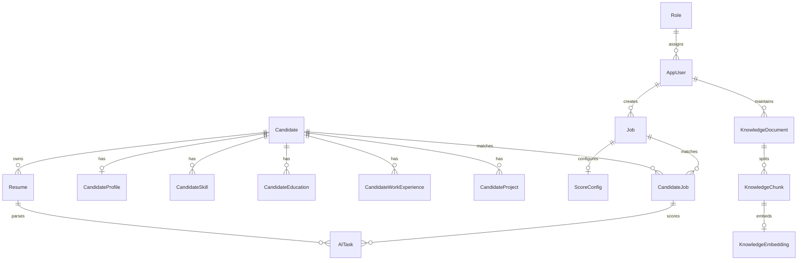

# AI智能招聘筛选系统 V1 数据库设计说明书

> **2026-08-12 JSON-only基线**：`Resume.FileExtension`和`ResumeImportFile.FileExtension`仅允许`JSON`，导入来源仅允许`THIRD_PARTY_IMPORT`。正式文件存于`C:\Zhaopin\Resume\JSON`；Word/PDF、HRUpload及其扫描/分割字段仅属于历史模型，不再由当前系统写入。

| 项目 | 内容 |
|---|---|
| 系统名称 | AI智能招聘筛选系统（简历筛选阶段） |
| 文档版本 | V1.0 |
| 数据库 | Microsoft SQL Server |
| 数据库名称 | `RecruitAI` |
| 字符集建议 | 中文环境使用 `Chinese_PRC_100_CI_AS_SC_UTF8`；既有实例不支持 UTF-8 时使用实例默认中文排序规则 |
| 依据文档 | 《软件详细设计说明书V1》 |

## 1. 文档目的

本文档定义 V1 系统的数据库逻辑模型、物理表结构、主外键关系、约束、索引、数据生命周期和初始化脚本，供后端开发、AI Agent 开发、测试、部署和运维共同使用。

V1 数据库覆盖以下业务：

- HR 用户与角色管理；
- 候选人及多版本简历管理；
- 简历结构化解析结果管理；
- 招聘岗位与评分权重管理；
- 候选人和岗位的 AI 匹配、评分及人工复核；
- AI 异步任务调度与重试；
- RAG 知识文档、分块与向量数据管理；
- 清理操作及关键业务操作留痕。

## 2. 设计原则

1. **业务主键统一**：业务表使用 `BIGINT IDENTITY`，避免批量导入后主键容量不足。
2. **时间统一**：所有数据库时间保存为 UTC，字段类型使用 `DATETIME2(3)`；展示时由应用转换为北京时间。
3. **Unicode 支持**：文本字段使用 `NVARCHAR`，满足中文姓名、岗位和报告存储要求。
4. **文件与数据分离**：PDF/DOCX 文件保存在文件目录，数据库只保存路径、哈希、元数据及提取文本。
5. **AI 结果可追溯**：保存模型、提示词版本、结构化结果、原始返回、错误信息和人工调整信息。
6. **候选人不物理级联删除**：删除候选人采用软删除；替换旧简历时保留操作日志，避免误删审计数据。
7. **幂等与去重**：手机号、邮箱、文件 SHA-256 和任务业务键共同防止重复数据与重复处理。
8. **最小敏感信息暴露**：密码只保存安全哈希；简历原文和联系方式限制访问并纳入备份加密范围。

## 3. 逻辑数据模型



主要关系说明：

- 一个候选人可以有多份简历，但同一时刻仅一份为当前有效简历；
- 一个候选人有一份聚合档案，并可拥有多条技能、教育、工作和项目经历；
- 候选人与岗位是多对多关系，通过 `CandidateJob` 保存匹配结果；
- 一个岗位对应一套当前评分配置；配置变更后重新分析，评分快照仍保存在 `CandidateJob`；
- 一个知识文档拆成多个知识块，每个知识块对应一份当前向量；
- AI 任务通过目标类型和目标 ID 关联简历解析或岗位匹配对象，不使用多态外键。

## 4. 命名与通用规范

### 4.1 命名规范

- 表名使用 PascalCase 单数形式，如 `Candidate`、`CandidateJob`；
- 主键统一命名为 `Id`；
- 外键统一命名为 `<实体名>Id`；
- 时间字段以 `Time` 结尾；
- 布尔字段以 `Is` 开头，类型为 `BIT`；
- 主键、外键、唯一约束和检查约束分别以 `PK_`、`FK_`、`UQ_`、`CK_` 开头；
- 普通及唯一索引分别以 `IX_`、`UX_` 开头。

### 4.2 通用字段

核心业务表按需包含：

| 字段 | 类型 | 说明 |
|---|---|---|
| `Id` | `BIGINT IDENTITY(1,1)` | 主键 |
| `CreateTime` | `DATETIME2(3)` | UTC 创建时间 |
| `UpdateTime` | `DATETIME2(3)` | UTC 最后更新时间，由应用在更新时维护 |
| `RowVersion` | `ROWVERSION` | 乐观并发控制，不表示业务时间 |
| `IsDeleted` | `BIT` | 软删除标记，0 为有效 |

## 5. 数据字典

### 5.1 Role（角色）

| 字段 | 类型 | 必填 | 说明 |
|---|---|---:|---|
| Id | BIGINT IDENTITY | 是 | 主键 |
| Code | VARCHAR(30) | 是 | 角色编码：`ADMIN`、`HR` |
| Name | NVARCHAR(50) | 是 | 角色名称 |
| Description | NVARCHAR(200) | 否 | 描述 |
| CreateTime | DATETIME2(3) | 是 | 创建时间 |

约束：`Code` 唯一。

### 5.2 AppUser（系统用户）

| 字段 | 类型 | 必填 | 说明 |
|---|---|---:|---|
| Id | BIGINT IDENTITY | 是 | 主键 |
| RoleId | BIGINT | 是 | 所属角色 |
| UserName | NVARCHAR(50) | 是 | 登录名 |
| DisplayName | NVARCHAR(100) | 是 | 显示名称 |
| PasswordHash | NVARCHAR(500) | 是 | ASP.NET Core Identity 兼容的密码哈希，不存明文 |
| Email | NVARCHAR(254) | 否 | 联系邮箱 |
| Status | VARCHAR(20) | 是 | `ACTIVE`、`DISABLED`、`LOCKED` |
| LastLoginTime | DATETIME2(3) | 否 | 最后登录时间 |
| CreateTime | DATETIME2(3) | 是 | 创建时间 |
| UpdateTime | DATETIME2(3) | 是 | 更新时间 |
| RowVersion | ROWVERSION | 是 | 并发版本 |

约束：`UserName` 唯一；`RoleId` 引用 `Role`。

### 5.3 Candidate（候选人）

| 字段 | 类型 | 必填 | 说明 |
|---|---|---:|---|
| Id | BIGINT IDENTITY | 是 | 主键 |
| Name | NVARCHAR(100) | 是 | 姓名 |
| Phone | NVARCHAR(30) | 否 | 展示手机号 |
| PhoneNormalized | VARCHAR(30) | 否 | 仅去空格、短横线和括号后的手机号，不自动补国家码，用于去重 |
| Email | NVARCHAR(254) | 否 | 展示邮箱 |
| EmailNormalized | VARCHAR(254) | 否 | 小写且去空格后的邮箱，用于去重 |
| Source | NVARCHAR(100) | 否 | 来源平台或渠道 |
| Status | VARCHAR(20) | 是 | `NEW`、`ANALYZING`、`SCREENED`、`INTERVIEW`、`REJECTED`、`ARCHIVED` |
| IsDeleted | BIT | 是 | 软删除标记 |
| CreateTime | DATETIME2(3) | 是 | 创建时间 |
| UpdateTime | DATETIME2(3) | 是 | 更新时间 |
| RowVersion | ROWVERSION | 是 | 并发版本 |

去重规则：

1. 有手机号时，按 `PhoneNormalized` 精确匹配；
2. 无匹配时按 `EmailNormalized` 精确匹配；
3. JSON简历优先以 `ResumeSource + TalentId` 查找已有候选人；如果它与手机号或邮箱命中不同候选人，则整份导入失败并交由HR处理；
4. 仍无匹配时，以“姓名 + 最近工作单位 + 最近职位 + 工作起止时间”生成候选指纹，由应用提示 HR 确认，不直接数据库强制合并；
5. 已软删除候选人不参与匹配，可以重新录入。

### 5.4 Resume（简历）

| 字段 | 类型 | 必填 | 说明 |
|---|---|---:|---|
| Id | BIGINT IDENTITY | 是 | 主键 |
| CandidateId | BIGINT | 是 | 候选人 ID |
| FileName | NVARCHAR(260) | 是 | 原始文件名 |
| FileExtension | VARCHAR(10) | 是 | `PDF`、`DOCX` 或 `JSON` |
| FilePath | NVARCHAR(1000) | 是 | 服务器受控目录中的相对路径 |
| FileSize | BIGINT | 是 | 文件字节数 |
| OriginalFileSize | BIGINT | 否 | 分割后、去图优化前字节数；旧数据可空 |
| IsOptimized | BIT | 是 | 是否因超过20MB执行过安全去图优化 |
| TalentId | NVARCHAR(100) | 否 | 第三方人才ID；PDF/DOCX可空 |
| ResumeSource | NVARCHAR(100) | 否 | 简历来源；JSON取文件名首个下划线前缀，如 `51JOB`；PDF/DOCX取来源目录 |
| FileHash | CHAR(64) | 是 | 文件 SHA-256，小写十六进制 |
| RawText | NVARCHAR(MAX) | 否 | 提取后的纯文本 |
| ParseStatus | VARCHAR(20) | 是 | `WAITING`、`PARSING`、`SUCCESS`、`FAILED` |
| IsCurrent | BIT | 是 | 是否为候选人当前简历 |
| IsDeleted | BIT | 是 | 逻辑删除标记 |
| CreateTime | DATETIME2(3) | 是 | 上传时间 |
| UpdateTime | DATETIME2(3) | 是 | 更新时间 |
| RowVersion | ROWVERSION | 是 | 并发版本 |

约束：仅允许 PDF/DOCX/JSON；文件大小大于 0；同一候选人最多一条 `IsCurrent=1 AND IsDeleted=0` 的记录。`(ResumeSource,TalentId)` 建非唯一过滤索引，以支持同一人才的简历版本历史和快速身份匹配。

### 5.5 CandidateProfile（候选人聚合档案）

| 字段 | 类型 | 必填 | 说明 |
|---|---|---:|---|
| Id | BIGINT IDENTITY | 是 | 主键 |
| CandidateId | BIGINT | 是 | 候选人 ID，一对一唯一 |
| ResumeId | BIGINT | 是 | 本档案来源简历 |
| HighestEducation | NVARCHAR(50) | 否 | 最高学历 |
| TotalExperienceMonths | INT | 否 | 总工作月数 |
| CurrentCompany | NVARCHAR(200) | 否 | 当前/最近公司 |
| CurrentTitle | NVARCHAR(200) | 否 | 当前/最近职位 |
| Summary | NVARCHAR(MAX) | 否 | AI 生成的职业概述 |
| StructuredJson | NVARCHAR(MAX) | 是 | 完整结构化解析结果，必须为 JSON |
| ModelName | NVARCHAR(100) | 否 | 解析模型名称 |
| PromptVersion | VARCHAR(50) | 否 | 解析提示词版本 |
| ParseTime | DATETIME2(3) | 是 | 完成解析时间 |
| UpdateTime | DATETIME2(3) | 是 | 更新时间 |
| RowVersion | ROWVERSION | 是 | 并发版本 |

说明：`StructuredJson` 用于保存解析器新增但尚未进入关系字段的数据；常用筛选项必须落入独立字段或子表。

### 5.6 CandidateSkill（候选人技能）

| 字段 | 类型 | 必填 | 说明 |
|---|---|---:|---|
| Id | BIGINT IDENTITY | 是 | 主键 |
| CandidateId | BIGINT | 是 | 候选人 ID |
| SkillName | NVARCHAR(100) | 是 | 标准化技能名 |
| SkillLevel | VARCHAR(20) | 否 | `BEGINNER`、`INTERMEDIATE`、`ADVANCED`、`EXPERT` |
| ExperienceMonths | INT | 否 | 相关经验月数 |
| Evidence | NVARCHAR(1000) | 否 | 简历中的判断依据 |
| CreateTime | DATETIME2(3) | 是 | 创建时间 |

约束：同一候选人的 `SkillName` 唯一；经验月数不得小于 0。

### 5.7 CandidateEducation（教育经历）

| 字段 | 类型 | 必填 | 说明 |
|---|---|---:|---|
| Id | BIGINT IDENTITY | 是 | 主键 |
| CandidateId | BIGINT | 是 | 候选人 ID |
| SchoolName | NVARCHAR(200) | 是 | 学校名称 |
| Major | NVARCHAR(200) | 否 | 专业 |
| Degree | NVARCHAR(50) | 否 | 学历/学位 |
| StartDate | DATE | 否 | 开始日期 |
| EndDate | DATE | 否 | 结束日期 |
| Description | NVARCHAR(1000) | 否 | 补充说明 |

### 5.8 CandidateWorkExperience（工作经历）

| 字段 | 类型 | 必填 | 说明 |
|---|---|---:|---|
| Id | BIGINT IDENTITY | 是 | 主键 |
| CandidateId | BIGINT | 是 | 候选人 ID |
| CompanyName | NVARCHAR(200) | 是 | 公司名称 |
| JobTitle | NVARCHAR(200) | 否 | 职位名称 |
| StartDate | DATE | 否 | 开始日期 |
| EndDate | DATE | 否 | 结束日期，当前工作可为空 |
| Description | NVARCHAR(MAX) | 否 | 工作内容与成果 |
| IsCurrent | BIT | 是 | 是否为当前工作 |

### 5.9 CandidateProject（项目经历）

| 字段 | 类型 | 必填 | 说明 |
|---|---|---:|---|
| Id | BIGINT IDENTITY | 是 | 主键 |
| CandidateId | BIGINT | 是 | 候选人 ID |
| ProjectName | NVARCHAR(200) | 是 | 项目名称 |
| RoleName | NVARCHAR(200) | 否 | 项目角色 |
| Technology | NVARCHAR(1000) | 否 | 技术栈文本 |
| StartDate | DATE | 否 | 开始日期 |
| EndDate | DATE | 否 | 结束日期 |
| Description | NVARCHAR(MAX) | 否 | 项目内容、职责和成果 |

### 5.10 Job（岗位）

| 字段 | 类型 | 必填 | 说明 |
|---|---|---:|---|
| Id | BIGINT IDENTITY | 是 | 主键 |
| Name | NVARCHAR(200) | 是 | 岗位名称 |
| Description | NVARCHAR(MAX) | 否 | 岗位描述 |
| Requirement | NVARCHAR(MAX) | 是 | 综合岗位要求 |
| SkillRequirement | NVARCHAR(MAX) | 否 | 技能要求 |
| MinExperienceMonths | INT | 否 | 最低经验月数 |
| EducationRequirement | NVARCHAR(100) | 否 | 学历要求 |
| Status | VARCHAR(20) | 是 | `DRAFT`、`OPEN`、`CLOSED`、`ARCHIVED` |
| CreatedBy | BIGINT | 是 | 创建用户 |
| IsDeleted | BIT | 是 | 软删除标记 |
| CreateTime | DATETIME2(3) | 是 | 创建时间 |
| UpdateTime | DATETIME2(3) | 是 | 更新时间 |
| RowVersion | ROWVERSION | 是 | 并发版本 |

### 5.11 ScoreConfig（评分配置）

| 字段 | 类型 | 必填 | 说明 |
|---|---|---:|---|
| Id | BIGINT IDENTITY | 是 | 主键 |
| JobId | BIGINT | 是 | 岗位 ID，一对一唯一 |
| SkillWeight | DECIMAL(5,2) | 是 | 技能权重百分比 |
| ProjectWeight | DECIMAL(5,2) | 是 | 项目权重百分比 |
| ExperienceWeight | DECIMAL(5,2) | 是 | 工作经验权重百分比 |
| EducationWeight | DECIMAL(5,2) | 是 | 学历权重百分比 |
| RuleJson | NVARCHAR(MAX) | 否 | 具体评分规则 JSON |
| Version | INT | 是 | 配置版本，从 1 递增 |
| UpdatedBy | BIGINT | 是 | 最后修改人 |
| CreateTime | DATETIME2(3) | 是 | 创建时间 |
| UpdateTime | DATETIME2(3) | 是 | 更新时间 |
| RowVersion | ROWVERSION | 是 | 并发版本 |

约束：各权重范围为 0～100，四项权重之和必须等于 100。

### 5.12 CandidateJob（候选人岗位匹配）

| 字段 | 类型 | 必填 | 说明 |
|---|---|---:|---|
| Id | BIGINT IDENTITY | 是 | 主键 |
| CandidateId | BIGINT | 是 | 候选人 ID |
| JobId | BIGINT | 是 | 岗位 ID |
| SkillScore | DECIMAL(5,2) | 否 | 技能得分 0～100 |
| ProjectScore | DECIMAL(5,2) | 否 | 项目得分 0～100 |
| ExperienceScore | DECIMAL(5,2) | 否 | 经验得分 0～100 |
| EducationScore | DECIMAL(5,2) | 否 | 学历得分 0～100 |
| AIScore | DECIMAL(5,2) | 否 | AI 加权总分 |
| ManualScore | DECIMAL(5,2) | 否 | HR 调整后的最终分；为空时使用 AI 分 |
| Status | VARCHAR(20) | 是 | `PENDING`、`RECOMMENDED`、`HOLD`、`INTERVIEW`、`REJECTED` |
| AIReport | NVARCHAR(MAX) | 否 | AI 报告 JSON |
| Strengths | NVARCHAR(MAX) | 否 | 优势 JSON 数组 |
| Weaknesses | NVARCHAR(MAX) | 否 | 不足 JSON 数组 |
| Recommendation | NVARCHAR(500) | 否 | 推荐结论 |
| ScoreConfigVersion | INT | 否 | 评分时使用的配置版本 |
| ModelName | NVARCHAR(100) | 否 | 模型名称 |
| PromptVersion | VARCHAR(50) | 否 | 提示词版本 |
| ReviewedBy | BIGINT | 否 | 人工复核用户 |
| ReviewedTime | DATETIME2(3) | 否 | 人工复核时间 |
| CreateTime | DATETIME2(3) | 是 | 创建时间 |
| UpdateTime | DATETIME2(3) | 是 | 更新时间 |
| RowVersion | ROWVERSION | 是 | 并发版本 |

约束：同一候选人和岗位只有一条当前匹配记录；所有评分均在 0～100；JSON 字段必须是合法 JSON。

排序口径：`COALESCE(ManualScore, AIScore)` 降序，分数相同按 `UpdateTime` 降序。

### 5.13 AITask（AI 异步任务）

| 字段 | 类型 | 必填 | 说明 |
|---|---|---:|---|
| Id | BIGINT IDENTITY | 是 | 主键 |
| TaskType | VARCHAR(30) | 是 | `RESUME_IMPORT`、`RESUME_PARSE`、`MATCH_SCORE`、`KNOWLEDGE_EMBED` |
| ResumeImportFileId | BIGINT | 否 | 临时目录简历导入目标 |
| ResumeId | BIGINT | 否 | 简历解析目标 |
| CandidateJobId | BIGINT | 否 | 匹配评分目标 |
| KnowledgeDocumentId | BIGINT | 否 | 知识向量化目标 |
| Status | VARCHAR(20) | 是 | `WAITING`、`RUNNING`、`SUCCESS`、`FAILED`、`CANCELLED` |
| Priority | TINYINT | 是 | 0～9，数值越大优先级越高 |
| RetryCount | INT | 是 | 已重试次数 |
| MaxRetryCount | INT | 是 | 最大重试次数 |
| BusinessKey | VARCHAR(200) | 否 | 调用方幂等键 |
| RequestJson | NVARCHAR(MAX) | 否 | 任务输入快照 |
| ResultJson | NVARCHAR(MAX) | 否 | 成功结果摘要 |
| ErrorMessage | NVARCHAR(MAX) | 否 | 最后一次错误信息 |
| WorkerId | NVARCHAR(100) | 否 | 当前 Worker 标识 |
| LockedUntil | DATETIME2(3) | 否 | 任务租约到期时间 |
| StartTime | DATETIME2(3) | 否 | 首次开始时间 |
| FinishTime | DATETIME2(3) | 否 | 完成时间 |
| NextRunTime | DATETIME2(3) | 是 | 下次可执行时间 |
| CreateTime | DATETIME2(3) | 是 | 创建时间 |
| UpdateTime | DATETIME2(3) | 是 | 更新时间 |
| RowVersion | ROWVERSION | 是 | 并发版本 |

约束：四种目标 ID 必须且只能填写与任务类型对应的一项。Worker 使用租约字段抢占任务；非简历任务崩溃后可按策略重新领取。`RESUME_IMPORT` 租约过期或执行失败时直接转FAILED，不重新排队，文件进入Failed等待HR人工处理。

### 5.14 KnowledgeDocument（知识文档）

| 字段 | 类型 | 必填 | 说明 |
|---|---|---:|---|
| Id | BIGINT IDENTITY | 是 | 主键 |
| Code | NVARCHAR(100) | 是 | 知识编码，规范化大写后全局唯一 |
| Title | NVARCHAR(300) | 是 | 标题 |
| DocumentType | VARCHAR(30) | 是 | `JOB_REQUIREMENT`、`TECH_STANDARD`、`TALENT_STANDARD`、`SCORE_RULE`、`OTHER` |
| Content | NVARCHAR(MAX) | 是 | 文档正文 |
| Status | VARCHAR(20) | 是 | `DRAFT`、`INDEXING`、`ACTIVE`、`FAILED`、`ARCHIVED` |
| ContentHash | CHAR(64) | 是 | 内容 SHA-256 |
| Version | INT | 是 | 文档版本 |
| CreatedBy | BIGINT | 是 | 创建用户 |
| IsDeleted | BIT | 是 | 软删除标记 |
| CreateTime | DATETIME2(3) | 是 | 创建时间 |
| UpdateTime | DATETIME2(3) | 是 | 更新时间 |
| RowVersion | ROWVERSION | 是 | 并发版本 |

### 5.15 KnowledgeChunk（知识分块）

| 字段 | 类型 | 必填 | 说明 |
|---|---|---:|---|
| Id | BIGINT IDENTITY | 是 | 主键 |
| KnowledgeDocumentId | BIGINT | 是 | 知识文档 ID |
| ChunkIndex | INT | 是 | 文档内从 0 开始的分块序号 |
| Content | NVARCHAR(MAX) | 是 | 分块正文 |
| TokenCount | INT | 否 | Token 数 |
| MetadataJson | NVARCHAR(MAX) | 否 | 标题层级、页码、标签等 JSON |
| ContentHash | CHAR(64) | 是 | 分块内容 SHA-256 |
| CreateTime | DATETIME2(3) | 是 | 创建时间 |

约束：同一文档的 `ChunkIndex` 唯一。

### 5.16 KnowledgeEmbedding（知识向量）

| 字段 | 类型 | 必填 | 说明 |
|---|---|---:|---|
| Id | BIGINT IDENTITY | 是 | 主键 |
| KnowledgeChunkId | BIGINT | 是 | 知识块 ID，一对一唯一 |
| EmbeddingModel | NVARCHAR(100) | 是 | 向量模型名称 |
| Dimension | INT | 是 | 向量维度 |
| VectorData | VARBINARY(MAX) | 是 | 按约定序列化的 `float32[]` |
| CreateTime | DATETIME2(3) | 是 | 创建时间 |

说明：为兼容 SQL Server 2019/2022，V1 使用 `VARBINARY(MAX)` 保存向量，由 Python 服务完成相似度计算。若部署版本原生支持向量类型，可在压测后迁移为原生向量列和向量索引。

### 5.17 CleanupLog（清理日志）

| 字段 | 类型 | 必填 | 说明 |
|---|---|---:|---|
| Id | BIGINT IDENTITY | 是 | 主键 |
| ObjectType | VARCHAR(50) | 是 | 对象类型，如 `RESUME`、`CANDIDATE_JOB` |
| ObjectId | BIGINT | 是 | 对象 ID |
| Action | VARCHAR(50) | 是 | `SOFT_DELETE`、`REPLACE`、`PURGE_FILE` 等 |
| Reason | NVARCHAR(500) | 是 | 原因 |
| OperatorId | BIGINT | 否 | 操作用户；系统任务可为空 |
| DetailJson | NVARCHAR(MAX) | 否 | 操作前后摘要 JSON |
| CreateTime | DATETIME2(3) | 是 | 操作时间 |

日志只允许新增，不允许业务用户修改或删除。

### 5.18 ResumeImportBatch（简历导入批次）

| 字段 | 类型 | 必填 | 说明 |
|---|---|---:|---|
| Id | BIGINT IDENTITY | 是 | 主键 |
| BatchKey | UNIQUEIDENTIFIER | 是 | 批次唯一键 |
| Remark | NVARCHAR(500) | 否 | HR备注 |
| Status | VARCHAR(20) | 是 | REVIEWING/QUEUED/PROCESSING/SUCCESS/PARTIAL_SUCCESS/FAILED/CANCELLED |
| SourceFileCount | INT | 是 | 本批源文件数，最大100 |
| HrUploadCount | INT | 是 | HR来源数 |
| ThirdPartyCount | INT | 是 | 第三方来源数 |
| ResumeFileCount | INT | 是 | 分割后正式简历数，可超过100 |
| SuccessCount/FailedCount | INT | 是 | 成功/失败数 |
| CreatedBy/ConfirmedBy | BIGINT | 是/否 | 创建和确认HR |
| ConfirmTime/FinishTime | DATETIME2(3) | 否 | 确认/结束时间 |
| CreateTime/UpdateTime | DATETIME2(3) | 是 | UTC |
| RowVersion | ROWVERSION | 是 | 并发 |

### 5.19 ResumeImportFile（导入源文件）

| 字段 | 类型 | 必填 | 说明 |
|---|---|---:|---|
| Id | BIGINT IDENTITY | 是 | 主键 |
| BatchId | BIGINT | 是 | ResumeImportBatch FK |
| SourceType | VARCHAR(30) | 是 | HR_UPLOAD/THIRD_PARTY_IMPORT |
| OriginalFileName | NVARCHAR(260) | 是 | 原文件名 |
| FileExtension | VARCHAR(10) | 是 | PDF/DOCX/JSON |
| OriginalSourcePath | NVARCHAR(1000) | 是 | 原来源相对路径 |
| TempFilePath | NVARCHAR(1000) | 是 | Processing相对路径 |
| FileSize | BIGINT | 是 | 源文件大小，硬上限500MB |
| FileHash | CHAR(64) | 是 | SHA-256 |
| Status | VARCHAR(20) | 是 | REVIEW_READY/QUEUED/PROCESSING/SPLIT/SUCCESS/FAILED/REJECTED/RETURNED/PURGED |
| DetectedResumeCount | INT | 否 | 分割数量 |
| ErrorCode/ErrorMessage | VARCHAR(100)/NVARCHAR(2000) | 否 | 异常信息 |
| RetryCount | INT | 是 | 保留字段；RESUME_IMPORT不自动重试 |
| ReviewedBy/ReviewTime | BIGINT/DATETIME2(3) | 否 | 审阅信息 |
| CreateTime/UpdateTime | DATETIME2(3) | 是 | UTC |
| RowVersion | ROWVERSION | 是 | 并发 |

索引：`(BatchId,FileHash)`。同批Hash重复项分别登记并标记异常，因此该索引不唯一。Failed/Rejected文件不自动重试或删除，由HR人工清理并写CleanupLog。

### 5.20 ResumeImportBatchJob（导入目标岗位）

| 字段 | 类型 | 必填 | 说明 |
|---|---|---:|---|
| BatchId | BIGINT | 是 | 批次FK，联合主键 |
| JobId | BIGINT | 是 | 开放岗位FK，联合主键 |
| CreateTime | DATETIME2(3) | 是 | UTC |

### 5.21 ResumeImportResult（源文件到正式简历映射）

| 字段 | 类型 | 必填 | 说明 |
|---|---|---:|---|
| Id | BIGINT IDENTITY | 是 | 主键 |
| ImportFileId | BIGINT | 是 | ResumeImportFile FK |
| ResumeId | BIGINT | 是 | Resume FK，唯一 |
| SequenceNo | INT | 是 | 源文件内顺序，从1开始 |
| SourcePageStart/SourcePageEnd | INT | 否 | PDF来源页范围 |
| CreateTime | DATETIME2(3) | 是 | UTC |

约束：`(ImportFileId,SequenceNo)`唯一。合并源文件全部结果成功后才能删除源文件。

### 5.22 CandidateJobReview（人工复核历史）

| 字段 | 类型 | 必填 | 说明 |
|---|---|---:|---|
| Id | BIGINT IDENTITY | 是 | 主键 |
| CandidateJobId | BIGINT | 是 | CandidateJob FK |
| PreviousManualScore/NewManualScore | DECIMAL(5,2) | 否 | 变更前后人工分 |
| PreviousStatus/NewStatus | VARCHAR(20) | 是 | 变更前后状态 |
| Reason | NVARCHAR(500) | 是 | 复核理由 |
| ReviewedBy | BIGINT | 是 | HR用户FK |
| CreateTime | DATETIME2(3) | 是 | UTC |

只允许新增和查询，不允许修改或删除。

### 5.23 KnowledgeImportBatch（知识Excel导入批次）

| 字段 | 类型 | 必填 | 说明 |
|---|---|---:|---|
| Id | BIGINT IDENTITY | 是 | 主键 |
| OriginalFileName | NVARCHAR(260) | 是 | `.xlsx`原文件名 |
| FileHash | CHAR(64) | 是 | SHA-256 |
| Status | VARCHAR(20) | 是 | PARSED/CONFLICT/READY/IMPORTED/FAILED |
| TotalCount | INT | 是 | 最大5000 |
| ReadyCount/DuplicateCount | INT | 是 | 可导入/重复数 |
| ConflictCount/InvalidCount | INT | 是 | 冲突/错误数 |
| CreatedBy/ConfirmedBy | BIGINT | 是/否 | HR用户 |
| ConfirmTime | DATETIME2(3) | 否 | 确认时间 |
| CreateTime/UpdateTime | DATETIME2(3) | 是 | UTC |
| RowVersion | ROWVERSION | 是 | 并发 |

### 5.24 KnowledgeImportRow（知识Excel暂存行）

| 字段 | 类型 | 必填 | 说明 |
|---|---|---:|---|
| Id | BIGINT IDENTITY | 是 | 主键 |
| BatchId | BIGINT | 是 | KnowledgeImportBatch FK |
| RowNumber | INT | 是 | Excel原行号 |
| Code | NVARCHAR(100) | 是 | 规范化知识编码 |
| Title | NVARCHAR(300) | 是 | 标题 |
| DocumentType | VARCHAR(30) | 是 | 文档类型 |
| Content | NVARCHAR(MAX) | 是 | 纯文本内容 |
| ContentHash | CHAR(64) | 是 | 内容Hash |
| Status | VARCHAR(20) | 是 | READY/DUPLICATE/CONFLICT/INVALID/IMPORTED |
| ExistingDocumentId | BIGINT | 否 | 现有知识文档 |
| ErrorMessage | NVARCHAR(1000) | 否 | 冲突/错误 |
| UpdatedBy/UpdateTime | BIGINT/DATETIME2(3) | 否 | 页面修正信息 |
| RowVersion | ROWVERSION | 是 | 并发 |

约束：`(BatchId,RowNumber)`唯一。有CONFLICT/INVALID时禁止确认合并。

## 6. SQL Server 建表脚本

以下为V001的17张基础表初始化脚本，语法必须按SQL Server 2008 R2兼容级别100执行。第5.18～5.24节新增表，以及Resume、KnowledgeDocument、AITask新增字段已经由 `database/V002__web_import_review_knowledge.sql` 交付。本机开发库已验证为24张业务表；新环境必须先执行V001，再执行V002，禁止手工拼接数据字典执行。

```sql
CREATE DATABASE RecruitAI;
GO
USE RecruitAI;
GO

CREATE TABLE dbo.Role (
    Id          BIGINT IDENTITY(1,1) NOT NULL CONSTRAINT PK_Role PRIMARY KEY,
    Code        VARCHAR(30) NOT NULL,
    Name        NVARCHAR(50) NOT NULL,
    Description NVARCHAR(200) NULL,
    CreateTime  DATETIME2(3) NOT NULL CONSTRAINT DF_Role_CreateTime DEFAULT SYSUTCDATETIME(),
    CONSTRAINT UQ_Role_Code UNIQUE (Code)
);

CREATE TABLE dbo.AppUser (
    Id            BIGINT IDENTITY(1,1) NOT NULL CONSTRAINT PK_AppUser PRIMARY KEY,
    RoleId        BIGINT NOT NULL,
    UserName      NVARCHAR(50) NOT NULL,
    DisplayName   NVARCHAR(100) NOT NULL,
    PasswordHash  NVARCHAR(500) NOT NULL,
    Email         NVARCHAR(254) NULL,
    Status        VARCHAR(20) NOT NULL CONSTRAINT DF_AppUser_Status DEFAULT 'ACTIVE',
    LastLoginTime DATETIME2(3) NULL,
    CreateTime    DATETIME2(3) NOT NULL CONSTRAINT DF_AppUser_CreateTime DEFAULT SYSUTCDATETIME(),
    UpdateTime    DATETIME2(3) NOT NULL CONSTRAINT DF_AppUser_UpdateTime DEFAULT SYSUTCDATETIME(),
    RowVersion    ROWVERSION NOT NULL,
    CONSTRAINT FK_AppUser_Role FOREIGN KEY (RoleId) REFERENCES dbo.Role(Id),
    CONSTRAINT UQ_AppUser_UserName UNIQUE (UserName),
    CONSTRAINT CK_AppUser_Status CHECK (Status IN ('ACTIVE','DISABLED','LOCKED'))
);

CREATE TABLE dbo.Candidate (
    Id              BIGINT IDENTITY(1,1) NOT NULL CONSTRAINT PK_Candidate PRIMARY KEY,
    Name            NVARCHAR(100) NOT NULL,
    Phone           NVARCHAR(30) NULL,
    PhoneNormalized VARCHAR(30) NULL,
    Email           NVARCHAR(254) NULL,
    EmailNormalized VARCHAR(254) NULL,
    Source          NVARCHAR(100) NULL,
    Status          VARCHAR(20) NOT NULL CONSTRAINT DF_Candidate_Status DEFAULT 'NEW',
    IsDeleted       BIT NOT NULL CONSTRAINT DF_Candidate_IsDeleted DEFAULT 0,
    CreateTime      DATETIME2(3) NOT NULL CONSTRAINT DF_Candidate_CreateTime DEFAULT SYSUTCDATETIME(),
    UpdateTime      DATETIME2(3) NOT NULL CONSTRAINT DF_Candidate_UpdateTime DEFAULT SYSUTCDATETIME(),
    RowVersion      ROWVERSION NOT NULL,
    CONSTRAINT CK_Candidate_Status CHECK (Status IN ('NEW','ANALYZING','SCREENED','INTERVIEW','REJECTED','ARCHIVED'))
);
CREATE UNIQUE INDEX UX_Candidate_PhoneNormalized
    ON dbo.Candidate(PhoneNormalized) WHERE PhoneNormalized IS NOT NULL AND IsDeleted = 0;
CREATE UNIQUE INDEX UX_Candidate_EmailNormalized
    ON dbo.Candidate(EmailNormalized) WHERE EmailNormalized IS NOT NULL AND IsDeleted = 0;
CREATE INDEX IX_Candidate_Status_UpdateTime ON dbo.Candidate(Status, UpdateTime DESC) WHERE IsDeleted = 0;
CREATE INDEX IX_Candidate_Name ON dbo.Candidate(Name) WHERE IsDeleted = 0;

CREATE TABLE dbo.Resume (
    Id            BIGINT IDENTITY(1,1) NOT NULL CONSTRAINT PK_Resume PRIMARY KEY,
    CandidateId   BIGINT NOT NULL,
    FileName      NVARCHAR(260) NOT NULL,
    FileExtension VARCHAR(10) NOT NULL,
    FilePath      NVARCHAR(1000) NOT NULL,
    FileSize      BIGINT NOT NULL,
    FileHash      CHAR(64) NOT NULL,
    RawText       NVARCHAR(MAX) NULL,
    TalentId      NVARCHAR(100) NULL,
    ResumeSource  NVARCHAR(100) NULL,
    ParseStatus   VARCHAR(20) NOT NULL CONSTRAINT DF_Resume_ParseStatus DEFAULT 'WAITING',
    IsCurrent     BIT NOT NULL CONSTRAINT DF_Resume_IsCurrent DEFAULT 1,
    IsDeleted     BIT NOT NULL CONSTRAINT DF_Resume_IsDeleted DEFAULT 0,
    CreateTime    DATETIME2(3) NOT NULL CONSTRAINT DF_Resume_CreateTime DEFAULT SYSUTCDATETIME(),
    UpdateTime    DATETIME2(3) NOT NULL CONSTRAINT DF_Resume_UpdateTime DEFAULT SYSUTCDATETIME(),
    RowVersion    ROWVERSION NOT NULL,
    CONSTRAINT FK_Resume_Candidate FOREIGN KEY (CandidateId) REFERENCES dbo.Candidate(Id),
    CONSTRAINT CK_Resume_Extension CHECK (FileExtension IN ('PDF','DOCX','JSON')),
    CONSTRAINT CK_Resume_FileSize CHECK (FileSize > 0),
    CONSTRAINT CK_Resume_ParseStatus CHECK (ParseStatus IN ('WAITING','PARSING','SUCCESS','FAILED'))
);
CREATE UNIQUE INDEX UX_Resume_Current ON dbo.Resume(CandidateId) WHERE IsCurrent = 1 AND IsDeleted = 0;
CREATE INDEX IX_Resume_FileHash ON dbo.Resume(FileHash) WHERE IsDeleted = 0;
CREATE INDEX IX_Resume_Source_TalentId ON dbo.Resume(ResumeSource,TalentId)
    WHERE TalentId IS NOT NULL AND ResumeSource IS NOT NULL AND IsDeleted = 0;

CREATE TABLE dbo.CandidateProfile (
    Id                    BIGINT IDENTITY(1,1) NOT NULL CONSTRAINT PK_CandidateProfile PRIMARY KEY,
    CandidateId           BIGINT NOT NULL,
    ResumeId              BIGINT NOT NULL,
    HighestEducation      NVARCHAR(50) NULL,
    TotalExperienceMonths INT NULL,
    CurrentCompany        NVARCHAR(200) NULL,
    CurrentTitle          NVARCHAR(200) NULL,
    Summary               NVARCHAR(MAX) NULL,
    StructuredJson        NVARCHAR(MAX) NOT NULL,
    ModelName             NVARCHAR(100) NULL,
    PromptVersion         VARCHAR(50) NULL,
    ParseTime             DATETIME2(3) NOT NULL CONSTRAINT DF_CandidateProfile_ParseTime DEFAULT SYSUTCDATETIME(),
    UpdateTime            DATETIME2(3) NOT NULL CONSTRAINT DF_CandidateProfile_UpdateTime DEFAULT SYSUTCDATETIME(),
    RowVersion            ROWVERSION NOT NULL,
    CONSTRAINT FK_CandidateProfile_Candidate FOREIGN KEY (CandidateId) REFERENCES dbo.Candidate(Id),
    CONSTRAINT FK_CandidateProfile_Resume FOREIGN KEY (ResumeId) REFERENCES dbo.Resume(Id),
    CONSTRAINT UQ_CandidateProfile_Candidate UNIQUE (CandidateId),
    CONSTRAINT CK_CandidateProfile_Experience CHECK (TotalExperienceMonths IS NULL OR TotalExperienceMonths >= 0),
    CONSTRAINT CK_CandidateProfile_Json CHECK (ISJSON(StructuredJson) = 1)
);

CREATE TABLE dbo.CandidateSkill (
    Id               BIGINT IDENTITY(1,1) NOT NULL CONSTRAINT PK_CandidateSkill PRIMARY KEY,
    CandidateId      BIGINT NOT NULL,
    SkillName        NVARCHAR(100) NOT NULL,
    SkillLevel       VARCHAR(20) NULL,
    ExperienceMonths INT NULL,
    Evidence         NVARCHAR(1000) NULL,
    CreateTime       DATETIME2(3) NOT NULL CONSTRAINT DF_CandidateSkill_CreateTime DEFAULT SYSUTCDATETIME(),
    CONSTRAINT FK_CandidateSkill_Candidate FOREIGN KEY (CandidateId) REFERENCES dbo.Candidate(Id),
    CONSTRAINT UQ_CandidateSkill_Name UNIQUE (CandidateId, SkillName),
    CONSTRAINT CK_CandidateSkill_Level CHECK (SkillLevel IS NULL OR SkillLevel IN ('BEGINNER','INTERMEDIATE','ADVANCED','EXPERT')),
    CONSTRAINT CK_CandidateSkill_Experience CHECK (ExperienceMonths IS NULL OR ExperienceMonths >= 0)
);
CREATE INDEX IX_CandidateSkill_SkillName ON dbo.CandidateSkill(SkillName, CandidateId);

CREATE TABLE dbo.CandidateEducation (
    Id          BIGINT IDENTITY(1,1) NOT NULL CONSTRAINT PK_CandidateEducation PRIMARY KEY,
    CandidateId BIGINT NOT NULL,
    SchoolName  NVARCHAR(200) NOT NULL,
    Major       NVARCHAR(200) NULL,
    Degree      NVARCHAR(50) NULL,
    StartDate   DATE NULL,
    EndDate     DATE NULL,
    Description NVARCHAR(1000) NULL,
    CONSTRAINT FK_CandidateEducation_Candidate FOREIGN KEY (CandidateId) REFERENCES dbo.Candidate(Id),
    CONSTRAINT CK_CandidateEducation_Date CHECK (StartDate IS NULL OR EndDate IS NULL OR EndDate >= StartDate)
);

CREATE TABLE dbo.CandidateWorkExperience (
    Id          BIGINT IDENTITY(1,1) NOT NULL CONSTRAINT PK_CandidateWorkExperience PRIMARY KEY,
    CandidateId BIGINT NOT NULL,
    CompanyName NVARCHAR(200) NOT NULL,
    JobTitle    NVARCHAR(200) NULL,
    StartDate   DATE NULL,
    EndDate     DATE NULL,
    Description NVARCHAR(MAX) NULL,
    IsCurrent   BIT NOT NULL CONSTRAINT DF_WorkExperience_IsCurrent DEFAULT 0,
    CONSTRAINT FK_WorkExperience_Candidate FOREIGN KEY (CandidateId) REFERENCES dbo.Candidate(Id),
    CONSTRAINT CK_WorkExperience_Date CHECK (StartDate IS NULL OR EndDate IS NULL OR EndDate >= StartDate)
);
CREATE INDEX IX_WorkExperience_Candidate_Date ON dbo.CandidateWorkExperience(CandidateId, StartDate DESC);

CREATE TABLE dbo.CandidateProject (
    Id          BIGINT IDENTITY(1,1) NOT NULL CONSTRAINT PK_CandidateProject PRIMARY KEY,
    CandidateId BIGINT NOT NULL,
    ProjectName NVARCHAR(200) NOT NULL,
    RoleName    NVARCHAR(200) NULL,
    Technology  NVARCHAR(1000) NULL,
    StartDate   DATE NULL,
    EndDate     DATE NULL,
    Description NVARCHAR(MAX) NULL,
    CONSTRAINT FK_CandidateProject_Candidate FOREIGN KEY (CandidateId) REFERENCES dbo.Candidate(Id),
    CONSTRAINT CK_CandidateProject_Date CHECK (StartDate IS NULL OR EndDate IS NULL OR EndDate >= StartDate)
);

CREATE TABLE dbo.Job (
    Id                      BIGINT IDENTITY(1,1) NOT NULL CONSTRAINT PK_Job PRIMARY KEY,
    Name                    NVARCHAR(200) NOT NULL,
    Description             NVARCHAR(MAX) NULL,
    Requirement             NVARCHAR(MAX) NOT NULL,
    SkillRequirement        NVARCHAR(MAX) NULL,
    MinExperienceMonths     INT NULL,
    EducationRequirement    NVARCHAR(100) NULL,
    Status                  VARCHAR(20) NOT NULL CONSTRAINT DF_Job_Status DEFAULT 'DRAFT',
    CreatedBy               BIGINT NOT NULL,
    IsDeleted               BIT NOT NULL CONSTRAINT DF_Job_IsDeleted DEFAULT 0,
    CreateTime              DATETIME2(3) NOT NULL CONSTRAINT DF_Job_CreateTime DEFAULT SYSUTCDATETIME(),
    UpdateTime              DATETIME2(3) NOT NULL CONSTRAINT DF_Job_UpdateTime DEFAULT SYSUTCDATETIME(),
    RowVersion              ROWVERSION NOT NULL,
    CONSTRAINT FK_Job_AppUser FOREIGN KEY (CreatedBy) REFERENCES dbo.AppUser(Id),
    CONSTRAINT CK_Job_Experience CHECK (MinExperienceMonths IS NULL OR MinExperienceMonths >= 0),
    CONSTRAINT CK_Job_Status CHECK (Status IN ('DRAFT','OPEN','CLOSED','ARCHIVED'))
);
CREATE INDEX IX_Job_Status_UpdateTime ON dbo.Job(Status, UpdateTime DESC) WHERE IsDeleted = 0;

CREATE TABLE dbo.ScoreConfig (
    Id               BIGINT IDENTITY(1,1) NOT NULL CONSTRAINT PK_ScoreConfig PRIMARY KEY,
    JobId            BIGINT NOT NULL,
    SkillWeight      DECIMAL(5,2) NOT NULL CONSTRAINT DF_ScoreConfig_Skill DEFAULT 40,
    ProjectWeight    DECIMAL(5,2) NOT NULL CONSTRAINT DF_ScoreConfig_Project DEFAULT 30,
    ExperienceWeight DECIMAL(5,2) NOT NULL CONSTRAINT DF_ScoreConfig_Experience DEFAULT 20,
    EducationWeight  DECIMAL(5,2) NOT NULL CONSTRAINT DF_ScoreConfig_Education DEFAULT 10,
    RuleJson         NVARCHAR(MAX) NULL,
    Version          INT NOT NULL CONSTRAINT DF_ScoreConfig_Version DEFAULT 1,
    UpdatedBy        BIGINT NOT NULL,
    CreateTime       DATETIME2(3) NOT NULL CONSTRAINT DF_ScoreConfig_CreateTime DEFAULT SYSUTCDATETIME(),
    UpdateTime       DATETIME2(3) NOT NULL CONSTRAINT DF_ScoreConfig_UpdateTime DEFAULT SYSUTCDATETIME(),
    RowVersion       ROWVERSION NOT NULL,
    CONSTRAINT FK_ScoreConfig_Job FOREIGN KEY (JobId) REFERENCES dbo.Job(Id),
    CONSTRAINT FK_ScoreConfig_AppUser FOREIGN KEY (UpdatedBy) REFERENCES dbo.AppUser(Id),
    CONSTRAINT UQ_ScoreConfig_Job UNIQUE (JobId),
    CONSTRAINT CK_ScoreConfig_Weights CHECK (
        SkillWeight BETWEEN 0 AND 100 AND ProjectWeight BETWEEN 0 AND 100
        AND ExperienceWeight BETWEEN 0 AND 100 AND EducationWeight BETWEEN 0 AND 100
        AND SkillWeight + ProjectWeight + ExperienceWeight + EducationWeight = 100
    ),
    CONSTRAINT CK_ScoreConfig_RuleJson CHECK (RuleJson IS NULL OR ISJSON(RuleJson) = 1),
    CONSTRAINT CK_ScoreConfig_Version CHECK (Version > 0)
);

CREATE TABLE dbo.CandidateJob (
    Id                 BIGINT IDENTITY(1,1) NOT NULL CONSTRAINT PK_CandidateJob PRIMARY KEY,
    CandidateId        BIGINT NOT NULL,
    JobId              BIGINT NOT NULL,
    SkillScore         DECIMAL(5,2) NULL,
    ProjectScore       DECIMAL(5,2) NULL,
    ExperienceScore    DECIMAL(5,2) NULL,
    EducationScore     DECIMAL(5,2) NULL,
    AIScore            DECIMAL(5,2) NULL,
    ManualScore        DECIMAL(5,2) NULL,
    Status             VARCHAR(20) NOT NULL CONSTRAINT DF_CandidateJob_Status DEFAULT 'PENDING',
    AIReport           NVARCHAR(MAX) NULL,
    Strengths          NVARCHAR(MAX) NULL,
    Weaknesses         NVARCHAR(MAX) NULL,
    Recommendation     NVARCHAR(500) NULL,
    ScoreConfigVersion INT NULL,
    ModelName          NVARCHAR(100) NULL,
    PromptVersion      VARCHAR(50) NULL,
    ReviewedBy         BIGINT NULL,
    ReviewedTime       DATETIME2(3) NULL,
    CreateTime         DATETIME2(3) NOT NULL CONSTRAINT DF_CandidateJob_CreateTime DEFAULT SYSUTCDATETIME(),
    UpdateTime         DATETIME2(3) NOT NULL CONSTRAINT DF_CandidateJob_UpdateTime DEFAULT SYSUTCDATETIME(),
    RowVersion         ROWVERSION NOT NULL,
    CONSTRAINT FK_CandidateJob_Candidate FOREIGN KEY (CandidateId) REFERENCES dbo.Candidate(Id),
    CONSTRAINT FK_CandidateJob_Job FOREIGN KEY (JobId) REFERENCES dbo.Job(Id),
    CONSTRAINT FK_CandidateJob_Reviewer FOREIGN KEY (ReviewedBy) REFERENCES dbo.AppUser(Id),
    CONSTRAINT UQ_CandidateJob_Candidate_Job UNIQUE (CandidateId, JobId),
    CONSTRAINT CK_CandidateJob_Status CHECK (Status IN ('PENDING','RECOMMENDED','HOLD','INTERVIEW','REJECTED')),
    CONSTRAINT CK_CandidateJob_Scores CHECK (
        (SkillScore IS NULL OR SkillScore BETWEEN 0 AND 100)
        AND (ProjectScore IS NULL OR ProjectScore BETWEEN 0 AND 100)
        AND (ExperienceScore IS NULL OR ExperienceScore BETWEEN 0 AND 100)
        AND (EducationScore IS NULL OR EducationScore BETWEEN 0 AND 100)
        AND (AIScore IS NULL OR AIScore BETWEEN 0 AND 100)
        AND (ManualScore IS NULL OR ManualScore BETWEEN 0 AND 100)
    ),
    CONSTRAINT CK_CandidateJob_Json CHECK (
        (AIReport IS NULL OR ISJSON(AIReport) = 1)
        AND (Strengths IS NULL OR ISJSON(Strengths) = 1)
        AND (Weaknesses IS NULL OR ISJSON(Weaknesses) = 1)
    )
);
CREATE INDEX IX_CandidateJob_Job_Ranking
    ON dbo.CandidateJob(JobId, Status, AIScore DESC, UpdateTime DESC)
    INCLUDE (CandidateId, ManualScore);
CREATE INDEX IX_CandidateJob_Candidate ON dbo.CandidateJob(CandidateId, UpdateTime DESC);

CREATE TABLE dbo.KnowledgeDocument (
    Id           BIGINT IDENTITY(1,1) NOT NULL CONSTRAINT PK_KnowledgeDocument PRIMARY KEY,
    Title        NVARCHAR(300) NOT NULL,
    DocumentType VARCHAR(30) NOT NULL,
    Content      NVARCHAR(MAX) NOT NULL,
    Status       VARCHAR(20) NOT NULL CONSTRAINT DF_KnowledgeDocument_Status DEFAULT 'DRAFT',
    ContentHash  CHAR(64) NOT NULL,
    Version      INT NOT NULL CONSTRAINT DF_KnowledgeDocument_Version DEFAULT 1,
    CreatedBy    BIGINT NOT NULL,
    IsDeleted    BIT NOT NULL CONSTRAINT DF_KnowledgeDocument_IsDeleted DEFAULT 0,
    CreateTime   DATETIME2(3) NOT NULL CONSTRAINT DF_KnowledgeDocument_CreateTime DEFAULT SYSUTCDATETIME(),
    UpdateTime   DATETIME2(3) NOT NULL CONSTRAINT DF_KnowledgeDocument_UpdateTime DEFAULT SYSUTCDATETIME(),
    RowVersion   ROWVERSION NOT NULL,
    CONSTRAINT FK_KnowledgeDocument_AppUser FOREIGN KEY (CreatedBy) REFERENCES dbo.AppUser(Id),
    CONSTRAINT CK_KnowledgeDocument_Type CHECK (DocumentType IN ('JOB_REQUIREMENT','TECH_STANDARD','TALENT_STANDARD','SCORE_RULE','OTHER')),
    CONSTRAINT CK_KnowledgeDocument_Status CHECK (Status IN ('DRAFT','INDEXING','ACTIVE','FAILED','ARCHIVED')),
    CONSTRAINT CK_KnowledgeDocument_Version CHECK (Version > 0)
);
CREATE INDEX IX_KnowledgeDocument_Status_Type ON dbo.KnowledgeDocument(Status, DocumentType) WHERE IsDeleted = 0;

CREATE TABLE dbo.KnowledgeChunk (
    Id                  BIGINT IDENTITY(1,1) NOT NULL CONSTRAINT PK_KnowledgeChunk PRIMARY KEY,
    KnowledgeDocumentId BIGINT NOT NULL,
    ChunkIndex          INT NOT NULL,
    Content             NVARCHAR(MAX) NOT NULL,
    TokenCount          INT NULL,
    MetadataJson        NVARCHAR(MAX) NULL,
    ContentHash         CHAR(64) NOT NULL,
    CreateTime          DATETIME2(3) NOT NULL CONSTRAINT DF_KnowledgeChunk_CreateTime DEFAULT SYSUTCDATETIME(),
    CONSTRAINT FK_KnowledgeChunk_Document FOREIGN KEY (KnowledgeDocumentId) REFERENCES dbo.KnowledgeDocument(Id),
    CONSTRAINT UQ_KnowledgeChunk_Document_Index UNIQUE (KnowledgeDocumentId, ChunkIndex),
    CONSTRAINT CK_KnowledgeChunk_Index CHECK (ChunkIndex >= 0),
    CONSTRAINT CK_KnowledgeChunk_Token CHECK (TokenCount IS NULL OR TokenCount >= 0),
    CONSTRAINT CK_KnowledgeChunk_Metadata CHECK (MetadataJson IS NULL OR ISJSON(MetadataJson) = 1)
);

CREATE TABLE dbo.KnowledgeEmbedding (
    Id               BIGINT IDENTITY(1,1) NOT NULL CONSTRAINT PK_KnowledgeEmbedding PRIMARY KEY,
    KnowledgeChunkId BIGINT NOT NULL,
    EmbeddingModel   NVARCHAR(100) NOT NULL,
    Dimension        INT NOT NULL,
    VectorData       VARBINARY(MAX) NOT NULL,
    CreateTime       DATETIME2(3) NOT NULL CONSTRAINT DF_KnowledgeEmbedding_CreateTime DEFAULT SYSUTCDATETIME(),
    CONSTRAINT FK_KnowledgeEmbedding_Chunk FOREIGN KEY (KnowledgeChunkId) REFERENCES dbo.KnowledgeChunk(Id),
    CONSTRAINT UQ_KnowledgeEmbedding_Chunk UNIQUE (KnowledgeChunkId),
    CONSTRAINT CK_KnowledgeEmbedding_Dimension CHECK (Dimension > 0)
);

CREATE TABLE dbo.AITask (
    Id                  BIGINT IDENTITY(1,1) NOT NULL CONSTRAINT PK_AITask PRIMARY KEY,
    TaskType            VARCHAR(30) NOT NULL,
    ResumeId            BIGINT NULL,
    CandidateJobId      BIGINT NULL,
    KnowledgeDocumentId BIGINT NULL,
    Status              VARCHAR(20) NOT NULL CONSTRAINT DF_AITask_Status DEFAULT 'WAITING',
    Priority            TINYINT NOT NULL CONSTRAINT DF_AITask_Priority DEFAULT 5,
    RetryCount          INT NOT NULL CONSTRAINT DF_AITask_RetryCount DEFAULT 0,
    MaxRetryCount       INT NOT NULL CONSTRAINT DF_AITask_MaxRetryCount DEFAULT 3,
    BusinessKey         VARCHAR(200) NULL,
    RequestJson         NVARCHAR(MAX) NULL,
    ResultJson          NVARCHAR(MAX) NULL,
    ErrorMessage        NVARCHAR(MAX) NULL,
    WorkerId            NVARCHAR(100) NULL,
    LockedUntil         DATETIME2(3) NULL,
    StartTime           DATETIME2(3) NULL,
    FinishTime          DATETIME2(3) NULL,
    NextRunTime         DATETIME2(3) NOT NULL CONSTRAINT DF_AITask_NextRunTime DEFAULT SYSUTCDATETIME(),
    CreateTime          DATETIME2(3) NOT NULL CONSTRAINT DF_AITask_CreateTime DEFAULT SYSUTCDATETIME(),
    UpdateTime          DATETIME2(3) NOT NULL CONSTRAINT DF_AITask_UpdateTime DEFAULT SYSUTCDATETIME(),
    RowVersion          ROWVERSION NOT NULL,
    CONSTRAINT FK_AITask_Resume FOREIGN KEY (ResumeId) REFERENCES dbo.Resume(Id),
    CONSTRAINT FK_AITask_CandidateJob FOREIGN KEY (CandidateJobId) REFERENCES dbo.CandidateJob(Id),
    CONSTRAINT FK_AITask_KnowledgeDocument FOREIGN KEY (KnowledgeDocumentId) REFERENCES dbo.KnowledgeDocument(Id),
    CONSTRAINT CK_AITask_Type CHECK (TaskType IN ('RESUME_PARSE','MATCH_SCORE','KNOWLEDGE_EMBED')),
    CONSTRAINT CK_AITask_Status CHECK (Status IN ('WAITING','RUNNING','SUCCESS','FAILED','CANCELLED')),
    CONSTRAINT CK_AITask_Priority CHECK (Priority BETWEEN 0 AND 9),
    CONSTRAINT CK_AITask_Retry CHECK (RetryCount >= 0 AND MaxRetryCount >= 0 AND RetryCount <= MaxRetryCount),
    CONSTRAINT CK_AITask_RequestJson CHECK (RequestJson IS NULL OR ISJSON(RequestJson) = 1),
    CONSTRAINT CK_AITask_ResultJson CHECK (ResultJson IS NULL OR ISJSON(ResultJson) = 1),
    CONSTRAINT CK_AITask_Target CHECK (
        (TaskType = 'RESUME_PARSE' AND ResumeId IS NOT NULL AND CandidateJobId IS NULL AND KnowledgeDocumentId IS NULL)
        OR (TaskType = 'MATCH_SCORE' AND ResumeId IS NULL AND CandidateJobId IS NOT NULL AND KnowledgeDocumentId IS NULL)
        OR (TaskType = 'KNOWLEDGE_EMBED' AND ResumeId IS NULL AND CandidateJobId IS NULL AND KnowledgeDocumentId IS NOT NULL)
    )
);
CREATE UNIQUE INDEX UX_AITask_BusinessKey ON dbo.AITask(BusinessKey) WHERE BusinessKey IS NOT NULL;
CREATE INDEX IX_AITask_Dequeue
    ON dbo.AITask(Status, NextRunTime, Priority DESC, CreateTime)
    INCLUDE (TaskType, RetryCount, MaxRetryCount, LockedUntil);

CREATE TABLE dbo.CleanupLog (
    Id          BIGINT IDENTITY(1,1) NOT NULL CONSTRAINT PK_CleanupLog PRIMARY KEY,
    ObjectType  VARCHAR(50) NOT NULL,
    ObjectId    BIGINT NOT NULL,
    Action      VARCHAR(50) NOT NULL,
    Reason      NVARCHAR(500) NOT NULL,
    OperatorId  BIGINT NULL,
    DetailJson  NVARCHAR(MAX) NULL,
    CreateTime  DATETIME2(3) NOT NULL CONSTRAINT DF_CleanupLog_CreateTime DEFAULT SYSUTCDATETIME(),
    CONSTRAINT FK_CleanupLog_AppUser FOREIGN KEY (OperatorId) REFERENCES dbo.AppUser(Id),
    CONSTRAINT CK_CleanupLog_DetailJson CHECK (DetailJson IS NULL OR ISJSON(DetailJson) = 1)
);
CREATE INDEX IX_CleanupLog_Object ON dbo.CleanupLog(ObjectType, ObjectId, CreateTime DESC);

INSERT INTO dbo.Role(Code, Name, Description)
VALUES ('ADMIN', N'管理员', N'拥有全部系统权限'),
       ('HR', N'HR', N'拥有招聘业务相关权限');
GO
```

## 7. 关键业务事务设计

### 7.1 临时目录审阅确认、正式导入与候选人去重

Web 扫描阶段与正式导入阶段分离。Web 每次从两个临时来源目录原子认领最多 100 个稳定源文件，写入导入暂存批次供 HR 审阅；该阶段不得创建 Candidate、Resume 或正式分析结果。暂存表模型以《WEB开发部分详细设计》第 11 节为准，确认后通过数据库版本脚本新增。

HR确认后创建 `RESUME_IMPORT` 任务。Agent 对每个文件执行物理分割和解析；正式数据库写入必须使用 `READ COMMITTED` 事务，命中候选人时通过 `UPDLOCK, HOLDLOCK` 锁定对应候选人：

每批最多认领100个临时源文件。该上限不限制物理分割后的Resume数量；合并文件产生超过100份简历时继续完成当前批次。HR确认前不调用DeepSeek，也不写Candidate、Resume或预解析结果。

1. 校验并解析认领文件，第三方合并文档先生成物理分割结果；
2. 对每份结果计算 SHA-256，已存在完全相同正式简历时按幂等规则处理；
3. 标准化手机号和邮箱；
4. 依次按手机号、邮箱查询有效候选人；
5. 未匹配时创建 Candidate；姓名与工作经历相似时只标记为疑似重复，不自动合并；
6. 将正式文件原子移动到 `C:\Zhaopin\Resume` 的受控目标路径；
7. 将原当前简历的 `IsCurrent` 更新为 0并创建新 Resume；
8. 原子写入或替换 Profile、技能、教育、工作和项目数据；
9. 将既有 CandidateJob 状态重置为 PENDING，旧 AI 结果保留到新结果成功覆盖；
10. 写入来源到正式 Resume 的结果映射和 CleanupLog 后提交事务；
11. 仅在该源文件的全部结果完成后删除 Processing 和 SplitOutput 中对应文件。

正式文件移动成功但数据库事务失败时，必须将正式文件移入失败区或登记孤儿文件并补偿；数据库成功但临时文件删除失败时不回滚业务结果，记录 `TEMP_DELETE_FAILED` 并重试清理。部分分割结果成功时保留源文件和已成功映射，整份源文件标记失败并进入异常区。系统不自动重试该简历导入；HR清理异常文件后，如需重新处理，应将修复后的文件作为新的源文件重新放入临时来源目录，形成新的批次并重新执行去重检查。

### 7.2 AI 任务领取

多个 Python Worker 并发时，建议在短事务内使用 `UPDLOCK, READPAST, ROWLOCK` 领取一条可执行任务，并设置 5～10 分钟租约：

```sql
;WITH NextTask AS (
    SELECT TOP (1) *
    FROM dbo.AITask WITH (UPDLOCK, READPAST, ROWLOCK)
    WHERE Status = 'WAITING'
      AND NextRunTime <= SYSUTCDATETIME()
      AND (LockedUntil IS NULL OR LockedUntil < SYSUTCDATETIME())
    ORDER BY Priority DESC, CreateTime ASC
)
UPDATE NextTask
SET Status = 'RUNNING',
    WorkerId = @WorkerId,
    LockedUntil = DATEADD(MINUTE, 10, SYSUTCDATETIME()),
    StartTime = COALESCE(StartTime, SYSUTCDATETIME()),
    UpdateTime = SYSUTCDATETIME()
OUTPUT inserted.*;
```

除 `RESUME_IMPORT` 外，普通AI任务失败时采用指数退避，例如 1、5、15 分钟，达到 `MaxRetryCount` 后设为 `FAILED`；租约过期的 `RUNNING` 任务由巡检任务恢复为 `WAITING`。`RESUME_IMPORT` 首次执行失败后直接设为 `FAILED`，不得由巡检、租约恢复或人工“重试任务”接口重新排队；对应文件保留在异常区等待HR人工清理。

### 7.3 AI 评分入库

1. 读取候选人档案、岗位要求、评分配置和 RAG 结果；
2. 将四项分数限制在 0～100；
3. 后端按权重重新计算 `AIScore`，不直接信任模型返回的最终分；
4. 保存 `AIReport`、模型、提示词版本和 `ScoreConfigVersion`；
5. 根据阈值设置 `RECOMMENDED` 或 `HOLD`，但不自动设置 `INTERVIEW`；
6. HR 修改评分时只写 `ManualScore`、复核人和复核时间，原 AI 分保持不变。

计算公式：

```text
AIScore = SkillScore × SkillWeight / 100
        + ProjectScore × ProjectWeight / 100
        + ExperienceScore × ExperienceWeight / 100
        + EducationScore × EducationWeight / 100
```

## 8. 查询与索引策略

### 8.1 典型查询

候选人列表最终排序示例：

```sql
SELECT
    cj.Id AS CandidateJobId,
    c.Id AS CandidateId,
    c.Name,
    j.Name AS JobName,
    cj.AIScore,
    cj.ManualScore,
    COALESCE(cj.ManualScore, cj.AIScore) AS FinalScore,
    cj.Status,
    cj.UpdateTime
FROM dbo.CandidateJob cj
JOIN dbo.Candidate c ON c.Id = cj.CandidateId AND c.IsDeleted = 0
JOIN dbo.Job j ON j.Id = cj.JobId AND j.IsDeleted = 0
WHERE cj.JobId = @JobId
ORDER BY COALESCE(cj.ManualScore, cj.AIScore) DESC, cj.UpdateTime DESC;
```

说明：由于 `COALESCE` 排序不能完全利用普通索引，V1 的百份级简历规模可直接执行。数据量明显增长后，可增加持久化计算列 `FinalScore AS COALESCE(ManualScore, AIScore) PERSISTED` 并建立排序索引。

### 8.2 索引维护

- 上线初期每周检查碎片与统计信息，不固定对所有索引重建；
- 根据实际慢查询补充索引，避免为低频字段过度建索引；
- `RawText`、报告、知识正文和向量列不进入普通 B-Tree 索引；
- 若需全文检索候选人简历，可后续为 `Resume.RawText` 创建 SQL Server 全文索引。

## 9. 数据安全

1. 应用使用独立数据库账号，只授予所需表的读写权限，不授予 `db_owner`；
2. Python Worker 使用独立账号，仅访问 AI 任务、简历解析、匹配及知识库相关对象；
3. 密码采用 ASP.NET Core Identity 默认密码哈希策略，禁止自行加密或保存明文；
4. 数据库连接必须启用 TLS，生产连接串不得写入代码库；
5. 文件下载接口按候选人权限鉴权，不对外暴露服务器物理路径；
6. 数据库备份、简历目录备份和日志备份应加密并限制访问；
7. `RawText`、电话、邮箱属于个人信息，日志中应脱敏，不传入非必要的第三方服务；
8. AI 调用仅发送岗位分析所需的结构化信息，避免发送电话、邮箱、住址等无关信息。

## 10. 备份、恢复与保留策略

建议生产环境采用完整恢复模式：

- 每日一次完整备份；
- 每 6 小时一次差异备份；
- 每 15 分钟一次事务日志备份；
- 数据库与 `C:\Zhaopin\Resume` 正式文件目录使用同一恢复点编号；`ResumeTemp` 不作为正式备份数据源；
- 每月至少执行一次恢复演练，并记录 RPO/RTO；
- `AITask` 成功记录保留 90 天，失败记录保留 180 天后归档；
- `CleanupLog` 至少保留 2 年；
- 候选人及简历保存期限由企业隐私制度决定，到期后执行匿名化或物理清除；
- 物理清除先记录不可变审计摘要，再删除数据库正文、向量及文件。

## 11. 数据迁移与发布

1. 建表和变更脚本纳入版本控制，按 `V001__init.sql`、`V002__xxx.sql` 编号；
2. 所有结构变更先在测试库执行并验证回滚方案；
3. 禁止生产环境手工修改表结构；
4. 新增非空列时采用“新增可空列 → 回填 → 添加默认值/约束 → 改为非空”的在线迁移步骤；
5. 发布后校验表数、约束、索引、角色初始化数据及关键查询执行计划。

## 12. 验收检查清单

- [ ] 所有表、主键、外键、唯一约束及检查约束创建成功；
- [ ] `ADMIN`、`HR` 两个角色初始化成功；
- [ ] 相同有效手机号或邮箱无法创建两个候选人；
- [ ] 一个候选人同一时刻只能存在一份当前简历；
- [ ] 同一候选人和岗位只能存在一条匹配记录；
- [ ] 评分权重不等于 100 时数据库拒绝写入；
- [ ] 非法 JSON、非法状态和超范围评分无法写入；
- [ ] 多 Worker 并发领取时同一任务不会被同时执行；
- [ ] 非 `RESUME_IMPORT` 任务失败能够按策略重试，超过次数后进入 `FAILED`；
- [ ] `RESUME_IMPORT` 失败后不自动重试或删除，HR可在异常页面人工清理并留下审计记录；
- [ ] HR 人工评分不会覆盖原始 AI 分；
- [ ] 简历替换、删除和清理动作均能在 `CleanupLog` 查询；
- [ ] 数据库与简历文件能够按同一恢复点完成恢复。

## 13. V1 范围外事项

以下内容不在本次 V1 数据库范围内，后续版本按业务需要扩展：

- 人工面试排期、面试官日历及Offer管理；AI语音面试数据已由V013纳入；
- 多租户/多公司数据隔离；
- 完整组织架构和细粒度 RBAC 权限表；
- 候选人同意授权、隐私请求和自动匿名化工作流；
- 评分配置完整历史表与 AI 报告历史表；
- SQL Server 原生向量检索或独立向量数据库。

## 14. V010 岗位画像增量设计

`Job`表示可改名、可合并的简历类别；岗位描述和要求不再依赖名称匹配，而由`JobKnowledgeDocument`将岗位稳定关联到版本化`KnowledgeDocument`。

| 字段 | 类型 | 说明 |
|---|---|---|
| JobId | BIGINT | 内部岗位ID |
| KnowledgeDocumentId | BIGINT | 版本化知识文档ID |
| RelationType | VARCHAR(30) | PRIMARY_REQUIREMENT、SUPPLEMENT、TECH_STANDARD、TALENT_STANDARD或SCORE_RULE |
| IsPrimary | BIT | 是否为岗位当前主画像 |
| Priority | INT | 同岗位补充资料检索优先级 |
| CreatedBy/CreateTime | BIGINT/DATETIME2 | 创建审计 |

约束：`(JobId,KnowledgeDocumentId)`唯一；每个岗位最多一个`PRIMARY_REQUIREMENT + IsPrimary=1`。现有招聘计划岗位要求按标题匹配迁移，其余有效岗位自动补建DRAFT画像。评分任务创建时必须存在ACTIVE主画像，评分报告同时记录画像版本与评分配置版本。

## 15. V013 AI语音面试微信小程序增量

V013由`database/V013__ai_voice_interview_mini_program.sql`交付，详细字段、事务、安全和部署说明见《数据库补充_AI语音面试小程序_V1.md》。本增量只引用现有Candidate、CandidateJob、Job、Resume、KnowledgeDocument和AppUser，不建立重复候选人或岗位主档。

新增18张表：

1. 计划与题集：`InterviewPlan`、`InterviewQuestion`、`InterviewQuestionSet`、`InterviewSessionQuestion`、`InterviewQuestionSource`；
2. 小程序身份：`InterviewInvitation`、`InterviewWechatIdentity`、`InterviewAccessSession`；
3. 会话与证据：`InterviewSession`、`InterviewConsent`、`InterviewTurn`、`InterviewTranscriptCorrection`、`InterviewAsset`；
4. TRTC：`InterviewRtcTask`、`InterviewProviderEventInbox`；
5. 结论与审计：`InterviewReport`、`InterviewReview`、`InterviewAuditLog`。

同时新增`vw_InterviewManagementList`作为HR独立列表投影；扩展AITask的`InterviewQuestionSetId`和`InterviewSessionId`，增加`INTERVIEW_QUESTION_SET`、`INTERVIEW_REPORT`，并重建任务类型和目标互斥检查约束。

安全基线：补充验证码、微信OpenId/UnionId、手机号和小程序访问Token均不保存明文；验证码使用HMAC查找摘要加慢速加盐Verifier；长云端文件标识使用32字节摘要索引，避免SQL Server 2008 R2的900字节索引键限制。短信和邮件发送数据库对象推迟到后续通知工作包。

V013已在本机RecruitAI数据库兼容级别100下完成语法解析和“外层事务真实执行后整体回滚”验证：18张表、39个索引、AITask约束及HR视图均成功创建，回滚后开发库无残留对象。
